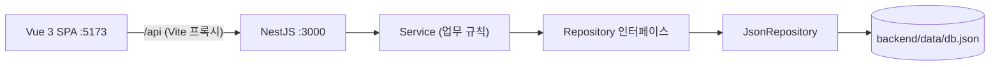
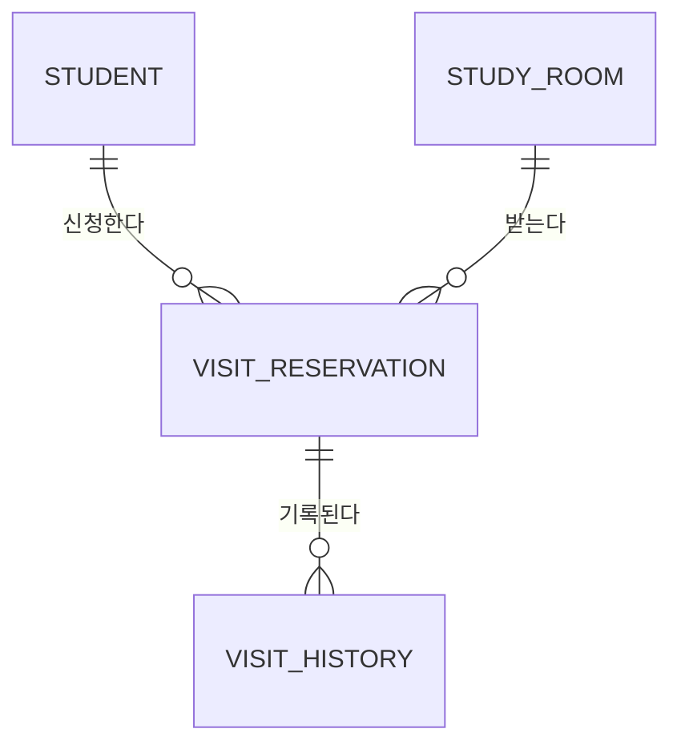

# 자습실 예약 시스템

강사가 자습실(최대 인원, 운영 기간)을 공개하고, 학생이 방문 시간을 정해 신청·수정·취소하는 MVP입니다.
신청·수정·취소 이력은 모두 남고, 정원·중복·운영 기간 규칙은 서버가 검사합니다.

- **프론트엔드**: Vue 3 + TypeScript (Vite, Vue Router, Pinia)
- **백엔드**: NestJS + TypeScript
- **저장소**: 프로젝트 내 JSON 파일 (`Repository` 인터페이스 뒤에 숨겨 DB로 교체 가능하게 설계)

## 구현 범위

| ID | 요구사항 | 구분 | 상태 |
| --- | --- | --- | --- |
| FR-ROM-01 | 자습실 목록 (삭제 제외) | 필수 | 완료 |
| FR-ROM-02 | 자습실 등록 | 필수 | 완료 |
| FR-ROM-03 | 자습실 상세의 신청·수정·취소 이력 | 필수 | 완료 |
| FR-ROM-04 | 최대 인원·운영 기간 수정 | 필수 | 완료 |
| FR-ROM-05 | 자습실 삭제 (Soft Delete) | 필수 | 완료 |
| FR-STD-01 | 학생 목록 | 필수 | 완료 |
| FR-VST-01 | 방문 신청 (운영 기간·정원·중복 검사) | 필수 | 완료 |
| FR-VST-02 | 방문 시간 수정 | 필수 | 완료 |
| FR-VST-03 | 방문 취소 | 필수 | 완료 |
| FR-VST-04 | 내 신청 목록 | 선택 | 완료 |
| FR-ROM-06 | 수정·삭제 시 기존 신청 처리 | 선택 | 완료 ([5장](#5-규칙-해석-애매한-부분에-대한-결정) 정책) |
| FR-STD-02 | 학생 등록·수정·삭제 | 선택 | **미구현** (접근 방식은 [6장](#6-개발하며-고민한-점--아쉬운-점)) |

---

## 1. 프로젝트 실행 방법

### 요구 환경

- **Node.js 22.18 이상 또는 24.12 이상** (프론트엔드 `engines` 기준. 개발·검증은 Node 26, npm 11, Windows 11에서 진행)
- 별도의 DB 설치는 필요 없습니다.

### 설치와 실행

터미널 두 개가 필요하고, **백엔드를 먼저** 실행합니다.

```bash
# 터미널 1 — 백엔드 (http://localhost:3000)
cd backend
npm install
npm run start:dev      # "Nest application successfully started" 가 보이면 준비 완료

# 터미널 2 — 프론트엔드 (http://localhost:5173)
cd frontend
npm install
npm run dev
```

브라우저에서 **http://localhost:5173** 에 접속합니다.
프론트엔드의 개발 서버가 `/api` 요청을 백엔드(`localhost:3000`)로 전달하므로(Vite 프록시) 별도의 CORS 설정은 필요 없습니다.
화면 상단에 "서버에 연결할 수 없습니다"가 보이면 백엔드가 아직 실행되지 않은 것입니다.

### Docker로 실행 (선택)

Node를 설치하지 않아도 Docker만 있으면 한 번에 실행할 수 있습니다. Docker Desktop을 먼저 켜 두세요.

```bash
docker compose up -d --build     # 프로젝트 루트에서
```

브라우저에서 **http://localhost:8080** 에 접속합니다. 8080이 이미 사용 중이면 포트를 바꿔 실행합니다.

```bash
# macOS / Linux / Git Bash
WEB_PORT=8081 docker compose up -d --build
# Windows PowerShell
$env:WEB_PORT='8081'; docker compose up -d --build
```

| 명령 | 설명 |
| --- | --- |
| `docker compose down` | 중지·삭제. **데이터는 볼륨(`db-data`)에 남습니다** |
| `docker compose down -v` | 데이터까지 삭제 (초기화) |
| `docker compose logs -f backend` | 백엔드 로그 보기 |

구성은 다음과 같습니다.

- `frontend` 컨테이너: Vue를 빌드해 nginx로 서빙하고, `/api` 요청을 `backend` 컨테이너로 전달합니다. 개발 환경의 Vite 프록시와 같은 역할이라 백엔드에 CORS 설정이 필요 없습니다.
- `backend` 컨테이너: 호스트에 포트를 열지 않고 nginx를 통해서만 접근합니다. JSON 파일(`/app/data/db.json`)은 named volume에 저장해 컨테이너를 다시 만들어도 유지됩니다.
- 두 이미지 모두 멀티 스테이지 빌드라서 실행 이미지에는 빌드 도구와 소스가 들어가지 않습니다.

### 화면 사용법

로그인은 생략했고, **화면 상단에서 역할을 고르는 방식**입니다.

| 역할 | 할 수 있는 일 |
| --- | --- |
| 강사 | 자습실 등록·수정·삭제, 자습실 상세에서 신청·수정·취소 이력 조회, 학생 목록 조회 |
| 학생 (학생도 선택) | 자습실 방문 신청, 방문 시간 수정, 취소, 내 신청 목록 조회 |

빠르게 확인하려면 이 순서를 추천합니다.

1. **강사**로 자습실을 등록합니다 (예: 최대 2명, 이번 주 운영 기간).
2. **학생**으로 바꿔 신청합니다. 같은 학생이 다시 신청하면 "이미 신청한 자습실" 오류가 납니다.
3. 다른 학생 2명으로 신청하면 두 번째 학생부터 정원 오류가 납니다. 한 명이 취소하면 그 자리에 다시 신청할 수 있습니다.
4. **강사**로 돌아와 자습실 상세의 **신청 이력**에서 신청·수정·취소가 시간순으로 남아 있는지 확인합니다.

### 테스트

```bash
cd backend  && npm test                 # 서비스 규칙, 동시성, 저장소 (Jest)
cd frontend && npx vitest run           # 날짜 변환 유틸 (Vitest)
cd frontend && npm run type-check       # 타입 검사
```

### 데이터와 환경 변수

- 데이터는 `backend/data/db.json`에 저장되고, 첫 실행 시 자동 생성되며 학생 5명이 시드로 들어갑니다. 이 폴더는 git에 포함되지 않습니다.
- 데이터를 초기화하려면 백엔드를 끄고 `backend/data/db.json`을 삭제한 뒤 다시 실행합니다.

| 환경 변수 | 기본값 | 설명 |
| --- | --- | --- |
| `PORT` | `3000` | 백엔드 포트 (바꾸면 `frontend/vite.config.ts`의 프록시 대상도 함께 변경) |
| `DB_FILE` | `backend/data/db.json` | JSON 데이터 파일 경로 |

### API 목록

모든 경로는 `/api` 아래에 있습니다.

| 메서드 | 경로 | 설명 | 요구사항 |
| --- | --- | --- | --- |
| GET | `/study-rooms` | 자습실 목록 (삭제 제외, `currentCount`가 현재 신청 인원) | FR-ROM-01 |
| GET | `/study-rooms/:id` | 자습실 상세 (삭제된 자습실도 조회 가능) | |
| POST | `/study-rooms` | 등록 `{name, maxPersonnel, startDate, endDate}` | FR-ROM-02 |
| PATCH | `/study-rooms/:id` | 수정 (보낸 필드만) | FR-ROM-04, 06 |
| DELETE | `/study-rooms/:id` | 삭제 (Soft Delete) | FR-ROM-05 |
| GET | `/study-rooms/:roomId/histories` | 신청·수정·취소 이력 (시간순) | FR-ROM-03 |
| GET | `/students` | 학생 목록 | FR-STD-01 |
| POST | `/study-rooms/:roomId/visits` | 방문 신청 `{studentId, visitAt}` | FR-VST-01 |
| PATCH | `/visits/:id` | 방문 시간 수정 `{studentId, visitAt}` | FR-VST-02 |
| POST | `/visits/:id/cancel` | 방문 취소 `{studentId}` | FR-VST-03 |
| GET | `/students/:studentId/visits` | 학생의 신청 목록 | FR-VST-04 |

---

## 2. 기술 스택과 선택 이유

| 영역 | 선택 | 이유 |
| --- | --- | --- |
| 프론트엔드 | Vue 3 (Composition API, `<script setup>`), TypeScript, Vite | 과제 필수 스택. 타입을 두어 서버 응답 모양을 화면 코드에서 컴파일 시점에 확인 |
| 상태 관리 | Pinia | "지금 누구로 보고 있는가(역할·학생)"만 전역 상태. 서버 데이터는 각 화면이 직접 불러와 상태를 단순하게 유지 |
| 라우팅 | Vue Router | 화면별 역할 제한(강사 전용·학생 전용)을 라우트 메타와 가드로 선언 |
| 백엔드 | NestJS, TypeScript | 과제 필수 스택. Module/Controller/Service/Provider 구조와 DI, Pipe·Filter·Interceptor가 계층 분리에 적합 |
| 입력 검증 | class-validator + `ValidationPipe` | DTO에 규칙을 선언하고 컨트롤러에 들어오기 전에 한 곳에서 검사. 정의되지 않은 필드는 거부 |
| 저장소 | JSON 파일 + `Repository` 인터페이스 | 과제에서 허용한 방식으로 설치 없이 바로 실행. 서비스는 인터페이스에만 의존하므로 실제 DB 구현체로 교체 가능 |
| 테스트 | Jest(백엔드), Vitest(프론트엔드) | 각 프레임워크의 기본 구성을 그대로 사용 |
| 배포(선택) | Docker, Docker Compose, nginx | 환경 차이 없이 명령 한 줄로 실행. 정적 파일 서빙과 `/api` 프록시를 nginx가 맡아 개발 환경과 같은 호출 경로를 유지 |

UI 라이브러리는 쓰지 않았습니다. 화면에 시간을 쓰기보다 서버 규칙과 설계에 집중하기 위해 최소한의 CSS만 사용했습니다.

---

## 3. 아키텍처와 컨벤션

### 전체 구조



요청 한 건이 지나가는 길입니다. 예: `POST /api/study-rooms/1/visits`

```
ValidationPipe      요청 body를 DTO 규칙으로 검사 (실패 → 400 VALIDATION_FAILED)
  → Controller      경로·파라미터를 받아 Service에 넘기기만 함 (규칙 없음)
  → Service         업무 규칙 검사 (정원·중복·기간 …), 위반 시 BusinessException
      db.transaction( 신청 저장 + 이력 추가 + 현재 인원 갱신 )   ← 한 덩어리로 커밋
  → ResponseInterceptor   성공 값을 { code:'OK', message, data } 로 감쌈
  (예외는 AllExceptionsFilter 가 { code, message, data } 로 변환)
```

### 디렉토리 구조

```
backend/src
  common/       공통: 에러 코드, BusinessException, 예외 필터, 응답 인터셉터, Clock
  storage/      Repository 인터페이스, JsonRepository, JsonDatabase(트랜잭션·낙관적 락)
  student/      학생: entity, service, controller, module
  study-room/   자습실: entity, dto, service, controller, module
  visit/        방문 신청·이력: entity, dto, service, controller, module
docker-compose.yml          backend / frontend 컨테이너와 데이터 볼륨 (각 폴더의 Dockerfile 사용)
frontend/src
  api/          서버 호출 (client: 응답 공통 처리, index: 엔드포인트별 함수, types)
  stores/       Pinia (역할·학생 선택)
  router/       라우트와 역할 가드
  views/        화면 (자습실 목록·상세, 학생 목록, 내 신청)
  components/   재사용 컴포넌트 (RoomForm)
  composables/  useAction (진행 상태·오류 문구 공통 처리)
  utils/        날짜 변환
```

| 계층 | 책임 | 하지 않는 것 |
| --- | --- | --- |
| Controller | 요청 매핑, 파라미터 변환 | 업무 규칙 |
| Service | 업무 규칙, 트랜잭션 경계 | HTTP 상태·응답 포맷 |
| Repository | 데이터 읽기·쓰기 | 업무 규칙 |
| common (Filter/Interceptor) | 응답·에러 포맷 통일 | 업무 로직 |

### 응답 포맷과 에러 처리

모든 응답은 같은 모양입니다.

```json
{ "code": "OK", "message": "성공", "data": { "...": "..." } }
{ "code": "ROOM_FULL", "message": "자습실 정원이 가득 찼습니다.", "data": null }
```

- 서비스는 `throw new BusinessException('ROOM_FULL')`처럼 **에러 코드만** 던지고, HTTP 상태와 메시지는 `common/error-code.ts`의 정의에서 정해집니다. 응답 변환은 `AllExceptionsFilter` 한 곳에서 합니다.
- 입력 검증 오류는 `VALIDATION_FAILED`로 통일하고, 상세 목록은 `data`에 담습니다.
- 규칙 위반 중 부가 정보가 필요한 경우 `data`로 내려줍니다 (예: 기간 변경으로 충돌하는 신청 번호 목록).

| 코드 | HTTP | 의미 |
| --- | --- | --- |
| `VALIDATION_FAILED` | 400 | 입력 형식 오류 |
| `INVALID_PERIOD` | 400 | 시작 일시가 종료 일시보다 늦거나 같음 |
| `OUT_OF_PERIOD` | 400 | 방문 시간이 운영 기간 밖 |
| `NOT_VISIT_OWNER` | 403 | 본인의 신청이 아님 |
| `ROOM_NOT_FOUND` / `STUDENT_NOT_FOUND` / `VISIT_NOT_FOUND` | 404 | 대상 없음 |
| `ROOM_DELETED` | 409 | 삭제된 자습실에는 신청·수정할 수 없음 |
| `ROOM_FULL` | 409 | 정원 초과 |
| `ALREADY_APPLIED` | 409 | 같은 학생의 중복 신청 |
| `VISIT_ALREADY_CANCELLED` | 409 | 이미 취소된 신청 |
| `CAPACITY_BELOW_APPLIED` | 409 | 최대 인원을 현재 신청 인원보다 작게 줄임 |
| `PERIOD_CONFLICTS_VISITS` | 409 | 운영 기간 변경으로 기존 신청이 기간 밖이 됨 |
| `CONCURRENT_MODIFICATION` | 409 | 동시 요청과 충돌해 재시도를 모두 소진 |
| `INTERNAL_ERROR` | 500 | 예상하지 못한 오류 (상세는 서버 로그에만 기록) |

### 코딩 컨벤션

- **네이밍**: 파일은 `kebab-case` + NestJS 접미사(`study-room.service.ts`), 클래스는 `PascalCase`, 에러 코드는 `UPPER_SNAKE_CASE`, API 경로는 복수형 `kebab-case`.
- **서식**: Prettier (백엔드·프론트엔드 각자의 설정 파일 사용), 프론트엔드는 oxlint·ESLint 적용.
- **날짜**: 서버는 항상 **UTC ISO 8601 문자열**로 저장·응답하고, 변환은 화면(`utils/datetime.ts`)에서만 합니다.
- **현재 시각**: 서비스에서 `new Date()`를 직접 쓰지 않고 `Clock`을 주입받습니다 (테스트에서 시각 고정).
- **쓰기**: 모든 쓰기는 `db.transaction()` 안에서만 가능합니다. 밖에서 호출하면 오류가 납니다.
- **커밋 메시지**: `[type] 내용` 형식. type은 `setup`, `feat`, `fix`, `refactor`, `style`, `docs`를 사용했습니다.

---

## 4. 데이터베이스 스키마와 설계 이유

### 엔티티 관계



데이터는 `backend/data/db.json`에 컬렉션 단위로 저장됩니다.

```json
{ "collections": { "students": [], "studyRooms": [], "visitReservations": [], "visitHistories": [] },
  "sequences":   { "students": 5 } }
```

### Student (학생)

| 필드 | 타입 | 설명 |
| --- | --- | --- |
| id | number | PK (컬렉션별 순번 발급) |
| version | number | 낙관적 락용 버전 (수정될 때마다 +1) |
| name, phone | string | 이름, 연락처 |
| createdAt, updatedAt | datetime | UTC ISO 문자열 |
| deletedAt | datetime \| null | Soft Delete (null = 삭제되지 않음) |

### StudyRoom (자습실)

| 필드 | 타입 | 설명 |
| --- | --- | --- |
| id | number | PK |
| version | number | 낙관적 락용 버전. **정원 보호의 기준**이 되는 행 |
| **name** | string | *추가 필드.* 화면에서 자습실을 구분하기 위함 |
| maxPersonnel | number | 최대 인원 (1 이상) |
| **currentCount** | number | *추가 필드.* 현재 신청 인원(취소 제외). 신청 시 +1, 취소 시 −1 |
| startDate, endDate | datetime | 운영 기간 (시작 < 종료) |
| createdAt, updatedAt | datetime | |
| deletedAt | datetime \| null | Soft Delete |

### VisitReservation (방문 신청 — 현재 상태)

| 필드 | 타입 | 설명 |
| --- | --- | --- |
| id, version | number | |
| roomId, studentId | number | 어느 자습실에 누가 |
| visitAt | datetime | 방문 시간 |
| status | `ACTIVE` \| `CANCELLED` | 신청 상태 |
| createdAt, updatedAt | datetime | |

### VisitHistory (신청·수정·취소 이력 — 추가만 함)

| 필드 | 타입 | 설명 |
| --- | --- | --- |
| id | number | |
| version | number | 저장소 공통 필드. 이력은 수정하지 않으므로 항상 0 |
| reservationId | number | 대상 신청 |
| roomId, studentId | number | 상세 화면에서 바로 조회하려고 함께 저장 (비정규화) |
| action | `CREATE` \| `UPDATE` \| `CANCEL` | 무슨 일이 있었나 |
| beforeVisitAt, afterVisitAt | datetime \| null | 변경 전·후 방문 시간 (신청은 `beforeVisitAt`이 null, 취소는 `afterVisitAt`이 null) |
| createdAt | datetime | 일어난 시각 |

### 설계 이유

**1. 신청(현재 상태)과 이력(변경 내역)을 분리했습니다.**
"현재 누가 신청해 있나"와 "무슨 일이 있었나"는 조회 목적이 다릅니다. 신청 행은 수정·취소 때 갱신하고, 이력은 **항상 새 행으로 추가만** 합니다. 그래서 정원 계산과 목록 조회는 신청 행만 보면 되고, 이력은 덮어써지지 않는 감사 기록이 됩니다. 수정 한 번당 이력 한 줄에 변경 전·후 시각이 남아, 학생의 "8시로 바꾸려는데 누구에게 말해요?"와 강사의 "누가 언제 바꿨나"에 모두 답할 수 있습니다.

**2. 현재 신청 인원을 `currentCount`로 저장했습니다.**
처음에는 취소되지 않은 신청을 세어 계산하는 방식도 검토했습니다. 값이 어긋날 일은 없지만, 정원 검사가 여러 행에 걸치게 되어 동시 요청을 안전하게 막기 어렵습니다. 값을 저장하면 **정원 검사 대상이 자습실 행 하나**가 되고, 그 행의 `version`이 곧 충돌 감지 장치가 됩니다. 대신 신청·취소 때 값을 빼먹으면 실제 신청 수와 어긋날 수 있어서 네 가지로 방어했습니다.

1. 값을 바꾸는 코드는 `VisitService.changeCount` **한 곳뿐**입니다.
2. 신청 상태 변경 · 이력 추가 · 카운터 갱신을 **한 트랜잭션**으로 묶어, 하나라도 실패하면 전부 반영되지 않습니다.
3. 값이 0 미만이거나 최대 인원을 넘게 되면 조용히 넘어가지 않고 예외를 던져 전체를 취소합니다.
4. 테스트에서 매번 "저장된 `currentCount` = 실제 `ACTIVE` 신청 수"를 검증합니다.

**3. 모든 행에 `version`을 두어 낙관적 락으로 동시성을 처리합니다.**
서버가 여러 대로 늘어나도 데이터 정합성을 지키기 위한 선택입니다 (뮤텍스는 서버 한 대 안에서만 유효).

```
A, B가 동시에 마지막 1자리에 신청
A: 자습실 읽기(version 5, 9/10) → 검사 통과 ┐
B: 자습실 읽기(version 5, 9/10) → 검사 통과 ┤
A: 커밋 — version 5 == 5 → 신청+이력+currentCount 저장, 자습실 version 6   (성공)
B: 커밋 — version 5 != 6 → 충돌 → 처음부터 재시도 → 10/10 을 읽고 ROOM_FULL   (정확히 거부)
```

- 트랜잭션 안의 쓰기는 바로 반영하지 않고 모아 두었다가, 커밋 때 `version`을 비교해 한 번에 적용합니다. 충돌하면 모아 둔 쓰기를 버리고 재시도(최대 5회)하므로 롤백도 따로 필요 없습니다.
- **정원은 여러 행에 걸친 규칙**이라(서로 다른 신청 행을 만드는 두 요청은 신청 행끼리 충돌하지 않음), 모든 신청·취소가 함께 건드리는 **자습실 행의 `version`**을 기준으로 삼았습니다. 시간 수정은 인원이 변하지 않지만 자습실 행을 갱신해 두어, 운영 기간 변경 요청과 동시에 일어나도 한쪽이 충돌로 감지됩니다.
- 재시도를 모두 쓰고도 충돌하면 `409 CONCURRENT_MODIFICATION`으로 응답합니다.
- 테스트: 정원 3인 자습실에 8명이 동시에 신청해도 정확히 3명만 성공하고 `currentCount`가 어긋나지 않는지, 같은 학생의 더블 클릭이 한 건만 만드는지 검증합니다.

**4. Soft Delete.** 학생·자습실 모두 `deletedAt`만 채웁니다. 삭제된 자습실의 이력은 계속 조회할 수 있습니다.

**5. 날짜는 UTC ISO 문자열.** 같은 형식의 문자열은 사전순 비교가 곧 시간순 비교라서, 운영 기간 검사가 단순하고 시간대 혼선이 없습니다.

**6. `Repository` 인터페이스.** 서비스는 `findAll / findById / create / update`만 압니다. 실제 DB로 바꿀 때는 구현체를 교체하면 되고, `version` 비교는 `UPDATE … WHERE id = ? AND version = ?`로, 이력과 신청의 한 트랜잭션은 DB 트랜잭션으로 그대로 옮겨집니다.

---

## 5. 규칙 해석 (애매한 부분에 대한 결정)

| 질문 | 결정 | 이유 |
| --- | --- | --- |
| "방문 시간"의 단위 | 시작 시각 하나(`visitAt`)로 해석. 시작~종료 구간은 받지 않음 | 문구 "방문 시간을 정해 신청"을 가장 단순하게 해석 |
| 정원의 범위 | **자습실 전체** 기준으로 계산 (시간대별 정원 아님) | 문구가 "자습실별 신청 인원". 시간대별 정원은 확장 과제로 둠 |
| 운영 기간 경계 | 시작·종료 시각 **자체는 포함** | 기간의 첫 순간과 마지막 순간 모두 방문 가능으로 해석 |
| 과거 시각 신청 | 현재 시각과의 비교는 하지 않고 운영 기간만 검사 | 요구사항에 없는 규칙을 더하지 않음 |
| 중복 신청 | 학생당 자습실당 **활성 신청 한 건** | 문구 "한 자습실에 한 건" |
| 취소 후 재신청 | 허용. 새 행이 아니라 **기존 신청 행을 다시 `ACTIVE`로** 되돌리고 이력에 `CREATE`를 남김 | 학생당 신청 행을 하나로 유지 |
| 방문 시간 수정과 정원 | 인원 변화 없음. 같은 시간으로 수정하면 변경 없음으로 보고 이력을 남기지 않음 | 정원은 자습실 단위, 이력 오염 방지 |
| 이미 취소한 신청의 취소·수정 | `VISIT_ALREADY_CANCELLED` 오류 | 인원이 두 번 줄거나 이력이 중복되는 것을 방지 |
| 삭제된 자습실 | 목록에서 제외. 상세·이력 조회 가능. **신청·수정 불가**, 학생의 **취소는 가능** | Soft Delete 취지. 취소는 학생에게 불리하지 않고 인원 정합성도 유지 |
| 삭제된 학생 | 신청 불가(`STUDENT_NOT_FOUND`), 기존 이력에는 이름이 그대로 표시 | Soft Delete 일관성 |
| 본인 확인 | 수정·취소 요청에 `studentId`를 받아 본인 신청이 아니면 `NOT_VISIT_OWNER` | 로그인이 없어도 "본인 신청만" 규칙은 지킴 |
| **최대 인원 축소 (FR-ROM-06)** | 현재 신청 인원보다 작게 줄이면 **거부**(409). 같은 값까지는 허용 | 학생 모르게 신청이 사라지지 않게, 강사가 먼저 판단 |
| **운영 기간 변경 (FR-ROM-06)** | 기간 밖으로 밀려나는 활성 신청이 있으면 **거부**하고, 영향받는 신청 번호를 `data`로 반환 | 자동 취소 대신 강사에게 선택권을 줌 |
| **자습실 삭제 (FR-ROM-06)** | Soft Delete. 기존 신청과 이력은 그대로 유지 | 이력 보존. 삭제 후에는 신규 신청·수정만 막음 |
| 입력 시간대 | 화면은 브라우저 시간대로 입력·표시, 서버는 UTC로 저장 | 시간대 변환을 화면 한 곳에 모음 |
| 인증 | 없음. 화면에서 고른 역할·학생을 그대로 신뢰 | 과제에서 로그인 생략을 허용. 실서비스에서는 토큰 기반 인증·인가가 필요 |

---

## 6. 개발하며 고민한 점 / 아쉬운 점

### 고민한 점

**동시성 처리: 직렬화(뮤텍스) → 낙관적 락으로 변경.**
처음에는 쓰기 트랜잭션을 한 번에 하나씩 실행하는 뮤텍스로 구현했습니다. 단순하고 확실하지만 **서버 한 대에서만** 유효합니다. 서버를 늘려도 정합성을 지키려면 잠금이 아니라 데이터 자체(`version`)에 검사를 두는 방식이 맞다고 판단해 바꿨습니다. 바꾸면서 두 가지가 따라왔습니다. 스냅샷을 되돌리는 롤백은 동시 트랜잭션이 커밋한 변경까지 지우므로 쓸 수 없어서, "쓰기를 모아 두었다가 커밋 때 검사"하는 방식으로 다시 설계했습니다. 또 정원은 여러 행에 걸친 규칙이라 신청 행의 `version`으로는 막을 수 없어서, 자습실 행을 기준으로 삼았습니다.

**현재 인원: 계산 vs 저장.**
계산은 어긋날 일이 없고, 저장은 낙관적 락과 맞습니다. 저장을 택하되 어긋남을 구조로 막는 방법(변경 지점 하나, 한 트랜잭션, 범위 검사, 불변식 테스트)을 [4장](#4-데이터베이스-스키마와-설계-이유)에 적었습니다. 테스트가 실제로 어긋남을 잡아내는지 확인하려고 신청 시 `+1`을 일부러 빼 보았고, 관련 테스트가 대부분 실패하는 것을 확인했습니다.

**규칙을 서버 한 곳에 둔 이유.**
화면의 `min/max`나 `disabled`는 편의 기능이고, 정원·중복·기간·본인 확인은 모두 서버가 최종 판단합니다. 화면은 서버가 준 오류 메시지를 그대로 보여 줍니다.

**이전 개발 경험과의 연결.**
예약과 배정 도메인에서 다뤘던 설계(활성 예약의 중복 방지, 이력 테이블 분리, 검증과 저장을 한 트랜잭션으로 처리)를 이 과제의 신청 모델에 대응해 적용했습니다. Vue 3와 NestJS는 이번 과제를 위해 학습했고, 기존에 익숙한 계층형 구조(Controller / Service / Repository)와 React 기반 개발 경험을 바탕으로 구조를 대응시켰습니다.

**AI 도구 사용.**
설계 검토와 코드 작성에 AI 도구(Claude Code)를 활용했습니다. 핵심 규칙(정원·중복 검사, 낙관적 락과 재시도, 이력 기록, `currentCount` 갱신)은 직접 검토하고 테스트로 동작을 확인했으며, 설명할 수 있도록 코드에 의도를 주석으로 남겼습니다.

### 아쉬운 점과 한계

- **JSON 저장소는 서버 1대 전용입니다.** 데이터를 프로세스 메모리에 올려 쓰기 때문에, 서버를 여러 대로 늘리려면 `Repository` 구현체를 실제 DB로 교체해야 합니다. 낙관적 락의 설계 자체(`version` 비교)는 그대로 옮겨지지만, 이 JSON 구현만으로는 다중 서버를 지원하지 않습니다.
- 저장할 때마다 파일 전체를 다시 씁니다(임시 파일에 쓴 뒤 이름을 바꿔 저장 도중 꺼져도 파일은 깨지지 않음). 데이터가 커지면 느려지고, 커밋 후 파일 저장이 실패하면 메모리와 파일이 어긋날 수 있습니다.
- **한 자습실에 신청이 몰리면 재시도가 늘어납니다.** 정원 보호 기준이 자습실 행 하나이기 때문입니다. 재시도를 모두 써도 충돌하면 409로 응답하고 사용자가 다시 시도하도록 했습니다.
- 정원은 자습실 전체 기준이고 시간대별로 나누지 않았습니다 (예: 7시 신청자와 8시 신청자를 따로 세기).
- 인증·인가가 없어 API가 `studentId`를 그대로 신뢰합니다.
- 목록 페이지네이션이 없고, 프론트엔드 테스트는 날짜 변환 유틸에 한정됩니다 (화면 단위·E2E 테스트 없음).
- 데이터베이스 수준의 유니크 제약이 없어서, "학생당 자습실당 한 건"은 서비스 로직과 자습실 행의 `version`으로 보장합니다. 실제 DB라면 `(room_id, student_id)` 유니크 인덱스를 함께 둘 것입니다.

### 미구현: FR-STD-02 (학생 등록·수정·삭제) 접근 방식

학생 모듈에 자습실과 같은 방식의 `POST / PATCH / DELETE /students`를 추가합니다 (DTO 검증, `version` 기반 수정, Soft Delete). 삭제 시에는 해당 학생의 활성 신청을 어떻게 할지 정해야 하는데, 자습실의 FR-ROM-06과 같은 원칙으로 **활성 신청이 있으면 삭제를 거부**하고 강사가 먼저 정리하도록 하는 안을 택할 예정입니다. 이미 삭제된 학생은 신청 대상에서 제외되고 이력의 이름은 유지되도록 구현되어 있어, 추가 작업은 학생 CRUD 엔드포인트와 화면입니다.

### 확장 아이디어

- 실제 DB(PostgreSQL 등) 구현체 교체와 `(room_id, student_id)` 유니크 인덱스
- 시간대별 정원, 대기 목록
- 로그인(JWT)과 역할 기반 접근 제어
- 신청 상태 변경 알림
