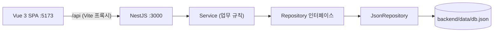
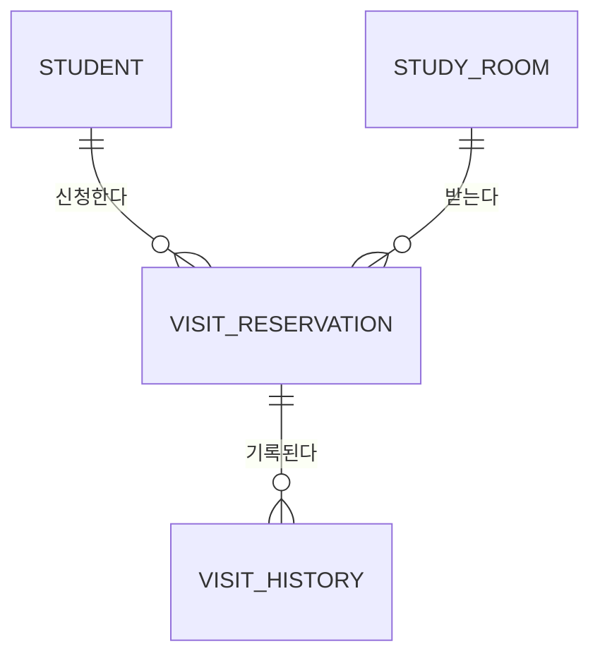

# 자습실 예약 시스템

강사가 자습실(최대 인원, 운영 기간)을 공개하고, 학생이 방문 시간을 정해 신청·수정·취소하는 MVP입니다.
신청·수정·취소 이력은 모두 남고, 정원·중복·운영 기간 규칙은 서버가 검사합니다.

- **프론트엔드**: Vue 3 + TypeScript (Vite, Vue Router, Pinia)
- **백엔드**: NestJS + TypeScript
- **저장소**: 프로젝트 내 JSON 파일 (`Repository` 인터페이스 뒤에 숨겨 DB로 교체 가능하게 설계)

## 구현 범위

| ID | 요구사항 | 구분 | 상태 |
| --- | --- | --- | --- |
| FR-ROM-01 | 자습실 목록 (삭제 제외) | 필수 | 완료 |
| FR-ROM-02 | 자습실 등록 | 필수 | 완료 |
| FR-ROM-03 | 자습실 상세의 신청·수정·취소 이력 | 필수 | 완료 |
| FR-ROM-04 | 최대 인원·운영 기간 수정 | 필수 | 완료 |
| FR-ROM-05 | 자습실 삭제 (Soft Delete) | 필수 | 완료 |
| FR-STD-01 | 학생 목록 | 필수 | 완료 |
| FR-VST-01 | 방문 신청 (운영 기간·정원·중복 검사) | 필수 | 완료 |
| FR-VST-02 | 방문 시간 수정 | 필수 | 완료 |
| FR-VST-03 | 방문 취소 | 필수 | 완료 |
| FR-VST-04 | 내 신청 목록 | 선택 | 완료 |
| FR-ROM-06 | 수정·삭제 시 기존 신청 처리 | 선택 | 완료 ([5장](#5-규칙-해석-애매한-부분에-대한-결정) 정책) |
| FR-STD-02 | 학생 등록·수정·삭제 | 선택 | 완료 (삭제 정책은 [5장](#5-규칙-해석-애매한-부분에-대한-결정)) |

추가 구현:
- **로그인과 역할별 화면**: 강사/학생 라디오 버튼 로그인, 비밀번호 해시·토큰, 서버의 역할별 권한 검사, 로그인 시도 제한
- **예약 규칙**: 예약 가능 기간(지금부터 3일 이내), **하루(한국 시간)에 신청 한 건**, 재원 학생만 신청, 종료된 자습실 등록 거부
- **학생 주소 검색**(카카오 우편번호)과 **자습실 사진 업로드**(SeaweedFS에 파일 저장)
- **부엉이 로고와 시대인재 홈페이지 분위기에 맞춘 화면**(Vuetify 테마)
- **Docker 실행**(frontend·backend·seaweedfs)과 **Oracle 전환**(선택)

설계 문서: [개발 환경](docs/01-개발환경.md) · [시스템 아키텍처](docs/02-시스템-아키텍처.md) · [데이터 모델](docs/03-데이터-모델.md)

---

## 1. 프로젝트 실행 방법

### 요구 환경

- **Node.js 22.18 이상 또는 24.12 이상** (프론트엔드 `engines` 기준. 개발·검증은 Node 26, npm 11, Windows 11에서 진행)
- 별도의 DB 설치는 필요 없습니다.

### 설치와 실행

터미널 두 개가 필요하고, **백엔드를 먼저** 실행합니다.

```bash
# 터미널 1 — 백엔드 (http://localhost:3000)
cd backend
npm install
npm run start:dev      # "Nest application successfully started" 가 보이면 준비 완료

# 터미널 2 — 프론트엔드 (http://localhost:5173)
cd frontend
npm install
npm run dev
```

브라우저에서 **http://localhost:5173** 에 접속합니다.
프론트엔드의 개발 서버가 `/api` 요청을 백엔드(`localhost:3000`)로 전달하므로(Vite 프록시) 별도의 CORS 설정은 필요 없습니다.
화면 상단에 "서버에 연결할 수 없습니다"가 보이면 백엔드가 아직 실행되지 않은 것입니다.

### Docker로 실행 (선택)

Node를 설치하지 않아도 Docker만 있으면 한 번에 실행할 수 있습니다. Docker Desktop을 먼저 켜 두세요.

```bash
docker compose up -d --build     # 프로젝트 루트에서
```

컨테이너는 3개입니다: `frontend`(nginx), `backend`, 그리고 자습실 사진을 저장하는 **`seaweedfs`**(SeaweedFS). 사진 파일은 `seaweed-data` 볼륨에 보관되어 컨테이너를 다시 만들어도 남고, SeaweedFS는 외부에 포트를 열지 않아 백엔드만 접근합니다.

브라우저에서 **http://localhost:8080** 에 접속합니다. 8080이 이미 사용 중이면 포트를 바꿔 실행합니다.

```bash
# macOS / Linux / Git Bash
WEB_PORT=8081 docker compose up -d --build
# Windows PowerShell
$env:WEB_PORT='8081'; docker compose up -d --build
```

| 명령 | 설명 |
| --- | --- |
| `docker compose down` | 중지·삭제. **데이터는 볼륨(`db-data`)에 남습니다** |
| `docker compose down -v` | 데이터까지 삭제 (초기화) |
| `docker compose logs -f backend` | 백엔드 로그 보기 |

구성은 다음과 같습니다.

- `frontend` 컨테이너: Vue를 빌드해 nginx로 서빙하고, `/api` 요청을 `backend` 컨테이너로 전달합니다. 개발 환경의 Vite 프록시와 같은 역할이라 백엔드에 CORS 설정이 필요 없습니다.
- `backend` 컨테이너: 호스트에 포트를 열지 않고 nginx를 통해서만 접근합니다. JSON 파일(`/app/data/db.json`)은 named volume에 저장해 컨테이너를 다시 만들어도 유지됩니다.
- 두 이미지 모두 멀티 스테이지 빌드라서 실행 이미지에는 빌드 도구와 소스가 들어가지 않습니다.
- 두 컨테이너 모두 `restart: unless-stopped`라서, 오류로 죽거나 서버를 재부팅해도 자동으로 다시 뜹니다 (Docker 서비스가 부팅 때 시작되도록 `sudo systemctl enable docker` 설정 필요). 그래서 `nohup` 같은 별도 백그라운드 실행은 필요 없습니다.

#### 리눅스 서버에 올리기

서버에 Docker 와 git 이 있으면 아래 순서로 올립니다. 포트는 `WEB_PORT`로 정합니다 (예: 18900).

```bash
git clone https://github.com/youngeiya/study-room-reservation.git
cd study-room-reservation

# 프로젝트 루트의 .env (git 에 올라가지 않으며 docker compose 가 자동으로 읽는다)
cat > .env <<EOF
WEB_PORT=18900
JWT_SECRET=$(openssl rand -hex 32)
INSTRUCTOR_ID=강사아이디
INSTRUCTOR_PASSWORD=강사비밀번호
# Oracle 을 쓸 때만 (생략하면 JSON 파일 DB)
DB_TYPE=oracle
ORACLE_USER=계정
ORACLE_PASSWORD=비밀번호
ORACLE_CONNECT_STRING=호스트:1521/FREEPDB1
EOF

docker compose up -d --build
```

- 접속: `http://서버주소:18900`. 접속이 안 되면 서버의 방화벽·보안 그룹에서 해당 포트가 열려 있는지 확인합니다.
- 코드 업데이트: `git pull && docker compose up -d --build`
- Oracle 이 같은 서버에서 돌고 있어 컨테이너에서 접속이 안 되면, `ORACLE_CONNECT_STRING`에 컨테이너가 닿을 수 있는 서버의 내부 IP 를 씁니다.
- **운영 전 필수**: `JWT_SECRET`을 무작위 긴 값으로, 강사 비밀번호를 데모 값이 아닌 것으로 바꾸고, 주소가 `http`라서 비밀번호가 암호화 없이 오가므로 외부에 공개한다면 앞단에 HTTPS(리버스 프록시)를 둡니다.

### 로그인과 화면 사용법

처음 화면은 **로그인**입니다. **라디오 버튼으로 강사/학생을 고르고** 로그인하면, 역할에 따라 서로 다른 화면(헤더 제목·메뉴·할 수 있는 일)이 열립니다.

| 로그인 유형 | 로그인 아이디 | 열리는 화면 | 할 수 있는 일 |
| --- | --- | --- | --- |
| 강사 | 강사 아이디 | `/instructor/...` 강사 관리 | 자습실 등록·수정·삭제, 신청·수정·취소 이력 조회, 학생 등록·수정·삭제 |
| 학생 | 학번 | `/student/...` 자습실 예약 | 방문 신청·시간 수정·취소, 내 신청 조회 |

- 계정(아이디·비밀번호)은 별도로 안내합니다. 학생 등록 때 강사가 초기 비밀번호를 정할 수 있고, 강사·학생 모두 상단의 이름 메뉴에서 **비밀번호를 변경**할 수 있습니다.
- 다른 역할의 주소(예: 학생이 `/instructor/rooms`)로 들어가면 자기 화면으로 돌려보내고, 서버도 모든 API에서 역할을 다시 검사합니다 (5장 "인증과 권한" 참고).

빠르게 확인하려면 이 순서를 추천합니다.

1. **강사**로 로그인해 자습실을 등록합니다 (예: 최대 2명, 이번 주 운영 기간).
2. 로그아웃하고 **학생**으로 로그인해 신청합니다. 같은 날(한국 시간)에 다시 신청하면 "같은 날짜에 이미 이 자습실을 신청했습니다" 오류가, 같은 날 다른 자습실에 신청하면 "같은 날짜에 다른 자습실을 이미 신청했습니다" 오류가 납니다. 날짜가 다르면(예: 오늘과 내일) 자습실이 같든 다르든 따로 신청할 수 있고, 취소하면 그날 다시 신청할 수 있습니다.
3. 다른 학생 2명으로 로그인해 신청하면 두 번째 학생부터 정원 오류(경고창)가 납니다. 한 명이 취소하면 그 자리에 다시 신청할 수 있습니다.
4. **강사**로 돌아와 자습실 상세의 **신청 이력**에서 신청·수정·취소가 시간순으로 남아 있는지 확인합니다.

### 테스트

```bash
cd backend  && npm test                 # 서비스 규칙(하루 1건·예약 가능 기간 포함), 동시성, 저장소, 로그인, 자습실 사진 (Jest)
cd backend  && npm run test:e2e         # 로그인·권한·사진 업로드를 실제 HTTP 요청으로 검증 (supertest)
cd frontend && npx vitest run           # 날짜 변환 유틸 (Vitest)
cd frontend && npm run type-check       # 타입 검사
```

Oracle 통합 테스트(선택)는 환경 변수가 있을 때만 실행되고, 없으면 건너뜁니다. 시작할 때 대상 스키마의 **모든 데이터를 지우므로 테스트 전용 빈 스키마**(`db/oracle/02_schema.sql`만 적용)로만 실행하세요.

```bash
cd backend
ORACLE_TEST_USER=... ORACLE_TEST_PASSWORD=... ORACLE_TEST_CONNECT_STRING=호스트:1521/FREEPDB1 npm test -- oracle.integration
```

정원 초과 동시 신청, 같은 학생의 동시 신청, 학번 동시 등록, 롤백 등을 실제 DB에서 확인합니다.

### 데이터와 환경 변수

- 데이터는 `backend/data/db.json`에 저장되고, 첫 실행 시 자동 생성되며 예시 데이터(학생 5명, 부엉이 라이브러리 1관·2관·3관, 최대 10명·10명·5명)가 시드로 들어갑니다. 자습실 시드는 어제부터 30일 뒤까지의 운영 기간으로 만들어져 바로 신청해 볼 수 있고, 자습실이 한 건이라도 있으면(삭제된 것 포함) 다시 넣지 않습니다. 이 폴더는 git에 포함되지 않습니다.
- 데이터를 초기화하려면 백엔드를 끄고 `backend/data/db.json`을 삭제한 뒤 다시 실행합니다.

| 환경 변수 | 기본값 | 설명 |
| --- | --- | --- |
| `PORT` | `3000` | 백엔드 포트 (바꾸면 `frontend/vite.config.ts`의 프록시 대상도 함께 변경) |
| `DB_TYPE` | `json` | 저장소 종류. `json`(기본, 설치 불필요) 또는 `oracle` |
| `DB_FILE` | `backend/data/db.json` | (`json`일 때) JSON 데이터 파일 경로 |
| `ORACLE_USER` / `ORACLE_PASSWORD` / `ORACLE_CONNECT_STRING` | 없음 | (`oracle`일 때 필수) 계정, 비밀번호, 접속 문자열 예) `host:1521/FREEPDB1` |
| `BOOKING_MAX_DAYS_AHEAD` | `3` | 예약 가능 기간(일). 지금부터 이 일수 이내의 방문 시간만 신청·수정할 수 있다. 학원 정책에 맞춰 바꾼다 |
| `LOGIN_MAX_ATTEMPTS` / `LOGIN_LOCK_MINUTES` | `5` / `5` | 로그인 연속 실패 허용 횟수와 잠금 시간(분). 한도에 이르면 그 계정의 로그인을 잠시 막는다 |
| `JWT_SECRET` | 서버가 뜰 때 임시 생성 | 로그인 토큰 서명 비밀키(16자 이상). 없으면 서버를 다시 켤 때 모두 다시 로그인해야 하므로 **운영에서는 반드시 지정** |
| `INSTRUCTOR_ID` / `INSTRUCTOR_PASSWORD` | 코드에 정해 둔 기본 계정 | 처음 실행할 때 만들어지는 기본 강사 계정 (강사 계정이 하나도 없을 때만 생성). **운영 전에 반드시 바꿀 것** |

환경 변수는 `backend/.env` 파일로도 줄 수 있습니다 ([backend/.env.example](backend/.env.example)을 복사). `.env`는 git에 올라가지 않습니다.

### Oracle로 실행 (선택)

기본은 JSON 파일이라 아무 설정이 필요 없습니다. 실서비스를 가정해 **같은 서비스 코드를 Oracle에서도 실행**할 수 있게 했고, 환경 변수만 바꾸면 전환됩니다.

1. [db/oracle/](db/oracle/)의 SQL로 스키마를 만듭니다 (`01_create_user.sql` → `02_schema.sql` → `03_seed.sql`). 로그인 기능이 생기기 전에 만든 스키마라면 `05_auth_migration.sql`을 추가로, 주소 필드가 생기기 전에 만든 스키마라면 `06_address_migration.sql`, 자습실 사진 기능이 생기기 전에 만든 스키마라면 `07_room_image_migration.sql`, "하루 1건" 규칙이 생기기 전에 만든 스키마라면 `08_one_visit_per_day_migration.sql`도 실행합니다.
2. 환경 변수를 설정하고 백엔드를 실행합니다. 프론트엔드는 바꿀 것이 없습니다.

```bash
# backend/.env
DB_TYPE=oracle
ORACLE_USER=studyroom
ORACLE_PASSWORD=비밀번호
ORACLE_CONNECT_STRING=호스트:1521/FREEPDB1
```

Docker에서는 같은 변수를 실행할 때 넘기면 됩니다: `DB_TYPE=oracle ORACLE_USER=... ORACLE_PASSWORD=... ORACLE_CONNECT_STRING=... docker compose up -d --build`. 드라이버는 `oracledb`의 Thin 모드라서 Oracle 클라이언트를 따로 설치할 필요가 없습니다.

### API 목록

모든 경로는 `/api` 아래에 있습니다.

| 메서드 | 경로 | 설명 | 요구사항 | 권한 |
| --- | --- | --- | --- | --- |
| POST | `/auth/login` | 로그인 `{role, loginId, password}` → `{token, user}` | 추가 | 공개 |
| GET | `/auth/me` | 토큰이 유효한지 확인하고 내 정보 | 추가 | 로그인 |
| PATCH | `/auth/password` | 내 비밀번호 변경 `{currentPassword, newPassword}` | 추가 | 로그인 |
| GET | `/booking-policy` | 예약 가능 기간 안내 `{maxDaysAhead}` (화면의 날짜 입력 범위·안내 문구에 사용) | 추가 | 로그인 |
| GET | `/study-rooms` | 자습실 목록 (삭제 제외, `currentCount`가 현재 신청 인원) | FR-ROM-01 | 로그인 |
| GET | `/study-rooms/:id` | 자습실 상세 (삭제된 자습실도 조회 가능) | | 로그인 |
| POST | `/study-rooms` | 등록 `{name, maxPersonnel, startDate, endDate}` | FR-ROM-02 | 강사 |
| PATCH | `/study-rooms/:id` | 수정 (보낸 필드만) | FR-ROM-04, 06 | 강사 |
| DELETE | `/study-rooms/:id` | 삭제 (Soft Delete) | FR-ROM-05 | 강사 |
| GET | `/study-rooms/:id/image` | 자습실 사진 원본(이미지 응답). ``가 토큰을 보낼 수 없어 **로그인 없이** 볼 수 있다 | 추가 | 공개 |
| POST | `/study-rooms/:id/image` | 사진 등록·교체 (multipart `file`, JPG·PNG·WEBP, 5MB 이하) | 추가 | 강사 |
| DELETE | `/study-rooms/:id/image` | 사진 삭제 | 추가 | 강사 |
| GET | `/study-rooms/:roomId/histories` | 신청·수정·취소 이력 (시간순) | FR-ROM-03 | 강사 |
| GET | `/students` | 학생 목록 (삭제 제외) | FR-STD-01 | 강사 |
| POST | `/students` | 학생 등록 `{name, phone, studentNo, password?, guardianPhone?, zipCode?, address?, addressDetail?, grade?, memo?}` | FR-STD-02 | 강사 |
| PATCH | `/students/:id` | 학생 수정 (보낸 필드만, `status`로 재원·휴원·퇴원 변경, `password`로 재설정, 선택 값은 `null`로 비움) | FR-STD-02 | 강사 |
| DELETE | `/students/:id` | 학생 삭제 (Soft Delete, 활성 신청이 있으면 거부) | FR-STD-02 | 강사 |
| POST | `/study-rooms/:roomId/visits` | 방문 신청 `{visitAt}` (신청자는 토큰의 학생) | FR-VST-01 | 학생 |
| PATCH | `/visits/:id` | 방문 시간 수정 `{visitAt}` (본인 신청만) | FR-VST-02 | 학생 |
| POST | `/visits/:id/cancel` | 방문 취소 (본인 신청만) | FR-VST-03 | 학생 |
| GET | `/students/:studentId/visits` | 학생의 신청 목록 (학생은 본인 것만, 강사는 누구든) | FR-VST-04 | 로그인 |

권한이 "로그인"이면 강사·학생 모두, "공개"는 로그인 없이 호출할 수 있습니다. 토큰은 `Authorization: Bearer <토큰>` 헤더로 보냅니다. 응답에는 비밀번호 해시가 포함되지 않습니다.

---

## 2. 기술 스택과 선택 이유

| 영역 | 선택 | 이유 |
| --- | --- | --- |
| 프론트엔드 | Vue 3 (Composition API, `<script setup>`), TypeScript, Vite | 과제 필수 스택. 타입을 두어 서버 응답 모양을 화면 코드에서 컴파일 시점에 확인 |
| UI | Vuetify 3 (Material Design) | 헤더·메뉴·카드·표 등 기본 부품을 제공하고, 좁은 화면에서는 메뉴가 햄버거 버튼으로 바뀌는 반응형 레이아웃을 쉽게 구성 |
| 상태 관리 | Pinia | "지금 누구로 보고 있는가(역할·학생)"만 전역 상태. 서버 데이터는 각 화면이 직접 불러와 상태를 단순하게 유지 |
| 라우팅 | Vue Router | 화면별 역할 제한(강사 전용·학생 전용)을 라우트 메타와 가드로 선언 |
| 백엔드 | NestJS, TypeScript | 과제 필수 스택. Module/Controller/Service/Provider 구조와 DI, Pipe·Filter·Interceptor가 계층 분리에 적합 |
| 입력 검증 | class-validator + `ValidationPipe` | DTO에 규칙을 선언하고 컨트롤러에 들어오기 전에 한 곳에서 검사. 정의되지 않은 필드는 거부 |
| 저장소 | JSON 파일(기본) / Oracle + `Database`·`Repository` 추상화 | JSON 은 과제에서 허용한 방식으로 설치 없이 바로 실행. 서비스는 추상 클래스에만 의존하므로 환경 변수(`DB_TYPE`)로 Oracle 구현체로 전환 (`oracledb` Thin 모드) |
| 사진 저장 | SeaweedFS (Filer HTTP API) | 이미지 파일을 DB 가 아닌 파일 저장소에 두고, DB 에는 경로(`imageKey`)만 저장한다. 파일이 DB 를 키우지 않고 나중에 서버를 늘려도 저장소를 공유할 수 있다. 저장소 접근은 `ImageStorage` 추상 클래스 뒤에 숨겨서(`Database` 와 같은 방식) 구현을 바꿔도 서비스는 그대로다 |
| 테스트 | Jest(백엔드), Vitest(프론트엔드) | 각 프레임워크의 기본 구성을 그대로 사용 |
| 배포(선택) | Docker, Docker Compose, nginx | 환경 차이 없이 명령 한 줄로 실행. 정적 파일 서빙과 `/api` 프록시를 nginx가 맡아 개발 환경과 같은 호출 경로를 유지 |

화면은 UI 라이브러리 **Vuetify**(Material Design)로 구성했습니다. 직접 스타일을 만드는 데 시간을 쓰기보다 서버 규칙과 설계에 집중하고, 카드·표·대화상자·반응형 메뉴 같은 기본 부품을 일관되게 쓰기 위해서입니다. (React의 MUI와 같은 Material Design을 Vue용으로 구현한 라이브러리입니다.)

화면의 로고(`frontend/public/logo.png`, 부엉이 일러스트)는 로그인 화면·상단 헤더·브라우저 탭 아이콘에 원본 비율 그대로 쓰며(`BrandLogo.vue`), 서비스 이름 "부엉이 라이브러리"와 맞췄습니다. 전체 화면은 시대인재 홈페이지의 분위기(흰 배경, 검정 포인트, 가는 선, 상단 텍스트 메뉴, 큰 제목, Pretendard 글꼴)에 맞춰 Vuetify 테마(`plugins/vuetify.ts`)와 전역 스타일(`assets/main.css`)로 통일했습니다. 글꼴은 CDN에서 불러오며, 불러오지 못하면 시스템 글꼴로 대신합니다.

---

## 3. 아키텍처와 컨벤션

### 전체 구조



요청 한 건이 지나가는 길입니다. 예: `POST /api/study-rooms/1/visits`

```
ValidationPipe      요청 body를 DTO 규칙으로 검사 (실패 → 400 VALIDATION_FAILED)
  → Controller      경로·파라미터를 받아 Service에 넘기기만 함 (규칙 없음)
  → Service         업무 규칙 검사 (정원·중복·기간 …), 위반 시 BusinessException
      db.transaction( 신청 저장 + 이력 추가 + 현재 인원 갱신 )   ← 한 덩어리로 커밋
  → ResponseInterceptor   성공 값을 { code:'OK', message, data } 로 감쌈
  (예외는 AllExceptionsFilter 가 { code, message, data } 로 변환)
```

### 디렉토리 구조

```
backend/src
  common/       공통: 에러 코드, BusinessException, 예외 필터, 응답 인터셉터, Clock
  storage/      Database·Repository 추상화, JsonDatabase(트랜잭션·낙관적 락), oracle/(OracleDatabase·OracleRepository·테이블 매핑)
  auth/         로그인: 토큰(JWT)·비밀번호 해시(scrypt)·전역 가드·@Roles/@Public 데코레이터
  instructor/   강사 계정: entity, service(기본 계정 생성), module
  student/      학생: entity, service, controller, module
  study-room/   자습실: entity, dto, service, controller, module
  visit/        방문 신청·이력: entity, dto, service, controller, module
docker-compose.yml          backend / frontend 컨테이너와 데이터 볼륨 (각 폴더의 Dockerfile 사용)
frontend/src
  api/          서버 호출 (client: 응답 공통 처리, index: 엔드포인트별 함수, types)
  stores/       Pinia (로그인 사용자·토큰)
  layouts/      역할별 화면 틀 (강사 관리 / 학생 예약)
  router/       라우트와 역할 가드
  views/        화면 (로그인, 자습실 목록·상세, 학생 관리, 내 신청)
  plugins/      Vuetify 설정 (테마, 아이콘, 한국어)
  components/   재사용 컴포넌트 (RoomForm)
  composables/  useAction (진행 상태·오류 문구 공통 처리)
  utils/        날짜 변환
```

| 계층 | 책임 | 하지 않는 것 |
| --- | --- | --- |
| Controller | 요청 매핑, 파라미터 변환 | 업무 규칙 |
| Service | 업무 규칙, 트랜잭션 경계 | HTTP 상태·응답 포맷 |
| Repository | 데이터 읽기·쓰기 | 업무 규칙 |
| common (Filter/Interceptor) | 응답·에러 포맷 통일 | 업무 로직 |

### 응답 포맷과 에러 처리

모든 응답은 같은 모양입니다.

```json
{ "code": "OK", "message": "성공", "data": { "...": "..." } }
{ "code": "ROOM_FULL", "message": "자습실 정원이 가득 찼습니다.", "data": null }
```

- 서비스는 `throw new BusinessException('ROOM_FULL')`처럼 **에러 코드만** 던지고, HTTP 상태와 메시지는 `common/error-code.ts`의 정의에서 정해집니다. 응답 변환은 `AllExceptionsFilter` 한 곳에서 합니다.
- 입력 검증 오류는 `VALIDATION_FAILED`로 통일하고, 상세 목록은 `data`에 담습니다.
- 규칙 위반 중 부가 정보가 필요한 경우 `data`로 내려줍니다 (예: 기간 변경으로 충돌하는 신청 번호 목록).

| 코드 | HTTP | 의미 |
| --- | --- | --- |
| `VALIDATION_FAILED` | 400 | 입력 형식 오류 |
| `INVALID_PERIOD` | 400 | 시작 일시가 종료 일시보다 늦거나 같음 |
| `OUT_OF_PERIOD` | 400 | 방문 시간이 운영 기간 밖 |
| `VISIT_TOO_FAR` | 400 | 방문 시간이 예약 가능 기간(지금부터 N일)보다 먼 미래 (`data.maxDaysAhead`) |
| `VISIT_IN_PAST` | 400 | 이미 지난 시간으로 신청·수정 |
| `ROOM_ALREADY_ENDED` | 400 | 종료 일시가 이미 지난 자습실을 등록하거나, 종료 일시를 과거로 수정 |
| `PERIOD_TOO_LONG` | 400 | 운영 기간이 366일을 넘음 |
| `NOT_VISIT_OWNER` | 403 | 본인의 신청이 아님 |
| `ROOM_NOT_FOUND` / `STUDENT_NOT_FOUND` / `VISIT_NOT_FOUND` | 404 | 대상 없음 (삭제된 학생의 수정·삭제도 `STUDENT_NOT_FOUND`) |
| `STUDENT_HAS_ACTIVE_VISITS` | 409 | 활성 신청이 남은 학생을 삭제하거나 휴원·퇴원으로 바꾸려 함 (`data.visitIds`에 그 신청들) |
| `STUDENT_NO_DUPLICATED` | 409 | 이미 쓰는 학번으로 등록·수정 |
| `STUDENT_NOT_ENROLLED` | 409 | 휴원·퇴원 학생이 방문을 신청 |
| `INVALID_CREDENTIALS` | 401 | 로그인 실패 (아이디가 없거나 비밀번호가 틀림 — 구분해 알려 주지 않음) |
| `UNAUTHORIZED` | 401 | 로그인하지 않았거나 토큰이 틀림·만료 |
| `TOO_MANY_LOGIN_ATTEMPTS` | 429 | 같은 계정으로 로그인에 연속 실패해 잠금 상태 (`data.retryAfterSeconds`) |
| `FORBIDDEN` | 403 | 로그인은 했지만 그 역할이 쓸 수 없는 기능 (예: 학생이 학생 목록 조회) |
| `WRONG_CURRENT_PASSWORD` | 400 | 비밀번호 변경 때 현재 비밀번호가 틀림 |
| `ROOM_DELETED` | 409 | 삭제된 자습실에는 신청·수정할 수 없음 |
| `ROOM_FULL` | 409 | 정원 초과 |
| `ALREADY_APPLIED` | 409 | 같은 학생이 같은 날(한국 시간)에 같은 자습실을 이미 신청 |
| `ALREADY_APPLIED_OTHER_ROOM` | 409 | 같은 학생이 같은 날 다른 자습실을 이미 신청 (`data.roomId`에 그 자습실) |
| `VISIT_ALREADY_CANCELLED` | 409 | 이미 취소된 신청 |
| `CAPACITY_BELOW_APPLIED` | 409 | 최대 인원을 현재 신청 인원보다 작게 줄임 |
| `PERIOD_CONFLICTS_VISITS` | 409 | 운영 기간 변경으로 기존 신청이 기간 밖이 됨 |
| `CONCURRENT_MODIFICATION` | 409 | 동시 요청과 충돌해 재시도를 모두 소진 |
| `INTERNAL_ERROR` | 500 | 예상하지 못한 오류 (상세는 서버 로그에만 기록) |

### 코딩 컨벤션

- **네이밍**: 파일은 `kebab-case` + NestJS 접미사(`study-room.service.ts`), 클래스는 `PascalCase`, 에러 코드는 `UPPER_SNAKE_CASE`, API 경로는 복수형 `kebab-case`.
- **서식**: Prettier (백엔드·프론트엔드 각자의 설정 파일 사용), 프론트엔드는 oxlint·ESLint 적용.
- **날짜**: 서버는 항상 **UTC ISO 8601 문자열**로 저장·응답하고, 변환은 화면(`utils/datetime.ts`)에서만 합니다.
- **현재 시각**: 서비스에서 `new Date()`를 직접 쓰지 않고 `Clock`을 주입받습니다 (테스트에서 시각 고정).
- **쓰기**: 모든 쓰기는 `db.transaction()` 안에서만 가능합니다. 밖에서 호출하면 오류가 납니다.
- **커밋 메시지**: `[type] 내용` 형식. type은 `setup`, `feat`, `fix`, `refactor`, `style`, `docs`를 사용했습니다.

---

## 4. 데이터베이스 스키마와 설계 이유

### 엔티티 관계



데이터는 `backend/data/db.json`에 컬렉션 단위로 저장됩니다.

```json
{ "collections": { "students": [], "studyRooms": [], "visitReservations": [], "visitHistories": [] },
  "sequences":   { "students": 5 } }
```

### Student (학생)

| 필드 | 타입 | 설명 |
| --- | --- | --- |
| id | number | PK (컬렉션별 순번 발급) |
| version | number | 낙관적 락용 버전 (수정될 때마다 +1) |
| name, phone | string | 이름, 연락처 (과제 필수 필드) |
| studentNo | string \| null | **학번(수강번호)**. 삭제되지 않은 학생끼리는 중복 불가 (부분 유니크). 동명이인·같은 번호를 구분하는 기준 |
| guardianPhone | string \| null | 학부모 연락처 (선택). 미성년 학생이 많은 학원에서 보호자 연락에 필요 |
| zipCode, address, addressDetail | string \| null | 우편번호(5자리)·도로명주소·상세주소 (선택). **카카오(다음) 우편번호 서비스** 팝업에서 고른 값을 저장하고 상세주소(동·호수)만 직접 입력. 승인키가 필요 없고 브라우저가 카카오 스크립트를 불러와 검색하며(데이터는 행정안전부 도로명주소 DB 기반), 서버는 검색에 관여하지 않는다 |
| grade | string \| null | 학년 (선택). 예) 고2 |
| memo | string \| null | 강사 메모 (선택, 최대 200자) |
| passwordHash | string \| null | **비밀번호 해시**(scrypt, salt 포함). 원문은 저장하지 않고 API 응답에도 내려주지 않는다. 학생의 로그인 아이디는 학번 |
| status | `ENROLLED` \| `ON_LEAVE` \| `WITHDRAWN` | **재원 상태** (재원/휴원/퇴원). 재원인 학생만 신청 가능. 실무에서는 학생을 지우지 않고 퇴원 처리하는 경우가 많아 삭제와 분리 |
| createdAt, updatedAt | datetime | UTC ISO 문자열 |
| deletedAt | datetime \| null | Soft Delete (null = 삭제되지 않음) |

학번을 비워 둘 수 있는(null) 이유는 **이전 버전에서 저장된 학생과의 호환** 때문입니다. 서버가 시작될 때 새 필드가 없는 이전 행은 기본값(재원, 값 없음)으로 채워집니다. 새로 등록하는 학생은 학번이 필수입니다. 이전 데이터 중 비밀번호가 없고 학번이 있는 학생은 서버가 시작될 때 학번을 초기 비밀번호로 채웁니다(학번이 없으면 강사가 학번을 정해 줄 때까지 로그인 불가). 주민번호 같은 정보는 개인정보 최소 수집 원칙에 따라 일부러 넣지 않았습니다.

### Instructor (강사 계정)

| 필드 | 타입 | 설명 |
| --- | --- | --- |
| id, version | number | PK, 낙관적 락용 버전 |
| loginId | string | 로그인 아이디 (중복 불가) |
| passwordHash | string | 비밀번호 해시 (원문 저장 안 함) |
| name | string | 표시 이름 |
| createdAt, updatedAt | datetime | UTC ISO 문자열 |

강사는 역할이 하나라서 계정 정보만 둡니다. 강사 계정이 하나도 없으면 서버가 시작할 때 기본 계정(`INSTRUCTOR_ID`/`INSTRUCTOR_PASSWORD` 환경 변수, 없으면 코드의 기본값)을 만듭니다.

### StudyRoom (자습실)

| 필드 | 타입 | 설명 |
| --- | --- | --- |
| id | number | PK |
| version | number | 낙관적 락용 버전. **정원 보호의 기준**이 되는 행 |
| **name** | string | *추가 필드.* 화면에서 자습실을 구분하기 위함 |
| maxPersonnel | number | 최대 인원 (1 이상) |
| **currentCount** | number | *추가 필드.* 현재 신청 인원(취소 제외). 신청 시 +1, 취소 시 −1 |
| **imageKey** | string \| null | *추가 필드.* 자습실 사진의 저장소 경로 (예: `rooms/1-<무작위>.png`). 사진 파일은 SeaweedFS 에 있다. 사진을 바꾸면 경로가 달라져 브라우저 캐시가 옛 사진을 보여 주지 않는다 |
| startDate, endDate | datetime | 운영 기간 (시작 < 종료) |
| createdAt, updatedAt | datetime | |
| deletedAt | datetime \| null | Soft Delete |

### VisitReservation (방문 신청 — 현재 상태)

| 필드 | 타입 | 설명 |
| --- | --- | --- |
| id, version | number | |
| roomId, studentId | number | 어느 자습실에 누가 |
| visitAt | datetime | 방문 시간 |
| status | `ACTIVE` \| `CANCELLED` | 신청 상태 |
| createdAt, updatedAt | datetime | |

### VisitHistory (신청·수정·취소 이력 — 추가만 함)

| 필드 | 타입 | 설명 |
| --- | --- | --- |
| id | number | |
| version | number | 저장소 공통 필드. 이력은 수정하지 않으므로 항상 0 |
| reservationId | number | 대상 신청 |
| roomId, studentId | number | 상세 화면에서 바로 조회하려고 함께 저장 (비정규화) |
| action | `CREATE` \| `UPDATE` \| `CANCEL` | 무슨 일이 있었나 |
| beforeVisitAt, afterVisitAt | datetime \| null | 변경 전·후 방문 시간 (신청은 `beforeVisitAt`이 null, 취소는 `afterVisitAt`이 null) |
| createdAt | datetime | 일어난 시각 |

### 설계 이유

**1. 신청(현재 상태)과 이력(변경 내역)을 분리했습니다.**
"현재 누가 신청해 있나"와 "무슨 일이 있었나"는 조회 목적이 다릅니다. 신청 행은 수정·취소 때 갱신하고, 이력은 **항상 새 행으로 추가만** 합니다. 그래서 정원 계산과 목록 조회는 신청 행만 보면 되고, 이력은 덮어써지지 않는 감사 기록이 됩니다. 수정 한 번당 이력 한 줄에 변경 전·후 시각이 남아, 학생의 "8시로 바꾸려는데 누구에게 말해요?"와 강사의 "누가 언제 바꿨나"에 모두 답할 수 있습니다.

**2. 현재 신청 인원을 `currentCount`로 저장했습니다.**
처음에는 취소되지 않은 신청을 세어 계산하는 방식도 검토했습니다. 값이 어긋날 일은 없지만, 정원 검사가 여러 행에 걸치게 되어 동시 요청을 안전하게 막기 어렵습니다. 값을 저장하면 **정원 검사 대상이 자습실 행 하나**가 되고, 그 행의 `version`이 곧 충돌 감지 장치가 됩니다. 대신 신청·취소 때 값을 빼먹으면 실제 신청 수와 어긋날 수 있어서 네 가지로 방어했습니다.

1. 값을 바꾸는 코드는 `VisitService.changeCount` **한 곳뿐**입니다.
2. 신청 상태 변경 · 이력 추가 · 카운터 갱신을 **한 트랜잭션**으로 묶어, 하나라도 실패하면 전부 반영되지 않습니다.
3. 값이 0 미만이거나 최대 인원을 넘게 되면 조용히 넘어가지 않고 예외를 던져 전체를 취소합니다.
4. 테스트에서 매번 "저장된 `currentCount` = 실제 `ACTIVE` 신청 수"를 검증합니다.

**3. 모든 행에 `version`을 두어 낙관적 락으로 동시성을 처리합니다.**
서버가 여러 대로 늘어나도 데이터 정합성을 지키기 위한 선택입니다 (뮤텍스는 서버 한 대 안에서만 유효).

```
A, B가 동시에 마지막 1자리에 신청
A: 자습실 읽기(version 5, 9/10) → 검사 통과 ┐
B: 자습실 읽기(version 5, 9/10) → 검사 통과 ┤
A: 커밋 — version 5 == 5 → 신청+이력+currentCount 저장, 자습실 version 6   (성공)
B: 커밋 — version 5 != 6 → 충돌 → 처음부터 재시도 → 10/10 을 읽고 ROOM_FULL   (정확히 거부)
```

- 트랜잭션 안의 쓰기는 바로 반영하지 않고 모아 두었다가, 커밋 때 `version`을 비교해 한 번에 적용합니다. 충돌하면 모아 둔 쓰기를 버리고 재시도(최대 5회)하므로 롤백도 따로 필요 없습니다.
- **정원은 여러 행에 걸친 규칙**이라(서로 다른 신청 행을 만드는 두 요청은 신청 행끼리 충돌하지 않음), 모든 신청·취소가 함께 건드리는 **자습실 행의 `version`**을 기준으로 삼았습니다. 시간 수정은 인원이 변하지 않지만 자습실 행을 갱신해 두어, 운영 기간 변경 요청과 동시에 일어나도 한쪽이 충돌로 감지됩니다.
- 재시도를 모두 쓰고도 충돌하면 `409 CONCURRENT_MODIFICATION`으로 응답합니다.
- 테스트: 정원 3인 자습실에 8명이 동시에 신청해도 정확히 3명만 성공하고 `currentCount`가 어긋나지 않는지, 같은 학생의 더블 클릭이 한 건만 만드는지 검증합니다.

**4. Soft Delete.** 학생·자습실 모두 `deletedAt`만 채웁니다. 삭제된 자습실의 이력은 계속 조회할 수 있습니다.

**5. 날짜는 UTC ISO 문자열.** 같은 형식의 문자열은 사전순 비교가 곧 시간순 비교라서, 운영 기간 검사가 단순하고 시간대 혼선이 없습니다.

**6. `Repository` 인터페이스.** 서비스는 `findAll / findById / create / update`만 압니다. 실제 DB로 바꿀 때는 구현체를 교체하면 되고, `version` 비교는 `UPDATE … WHERE id = ? AND version = ?`로, 이력과 신청의 한 트랜잭션은 DB 트랜잭션으로 그대로 옮겨집니다.

### Oracle 전환용 스크립트 (`db/oracle/`)

실서비스를 가정해 같은 구조를 Oracle 로 옮긴 SQL 을 [db/oracle/](db/oracle/)에 두었습니다. **현재 앱은 위의 JSON 저장소로 동작하며(별도 DB 설치 없이 실행), 이 스크립트는 DB 구현체로 교체할 때의 설계와 쿼리입니다.**

| 파일 | 내용 |
| --- | --- |
| `01_create_user.sql` | 업무별 스키마(사용자) `STUDYROOM` 생성과 최소 권한 (비밀번호는 실행 때 입력) |
| `02_schema.sql` | 테이블 5개(`student`, `instructor`, `study_room`, `visit_reservation`, `visit_history`), 제약조건, 인덱스 |
| `03_seed.sql` | 예시 데이터 (앱의 시드와 동일) |
| `04_queries.sql` | 신청·취소·수정·삭제·로그인 등 핵심 쿼리와 낙관적 락 UPDATE 예시 |
| `05_auth_migration.sql` | 로그인 기능 이전에 만든 스키마에 `student.password_hash`와 `instructor` 테이블을 추가하는 마이그레이션 |
| `06_address_migration.sql` | 주소 기능 이전에 만든 스키마에 `student.zip_code`, `address`, `address_detail` 컬럼을 추가하는 마이그레이션 |
| `08_one_visit_per_day_migration.sql` | "활성 신청 1건" 규칙을 "하루(한국 시간)에 1건"으로 바꾸는 마이그레이션 (`uq_visit_room_student` 제약과 `uq_visit_student_active` 인덱스를 지우고 `uq_visit_student_day` 인덱스를 만든다) |
| `07_room_image_migration.sql` | 사진 기능 이전에 만든 스키마에 `study_room.image_key` 컬럼을 추가하는 마이그레이션 |

서비스에서 하던 검사의 최종 방어선을 DB 제약으로도 둡니다. 예를 들어 `CHECK (current_count BETWEEN 0 AND max_personnel)`로 정원 초과·음수를 막고, 함수 기반 유니크 인덱스로 "삭제되지 않은 학생끼리 학번 유일"과 "학생당 하루 활성 신청 한 건"을 보장합니다. 위반 쿼리를 직접 실행해 제약이 거부하는 것과, `WHERE version = ?` 조건의 UPDATE 가 충돌 시 0행을 반환하는 것을 확인했습니다.

---

## 5. 규칙 해석 (애매한 부분에 대한 결정)

| 질문 | 결정 | 이유 |
| --- | --- | --- |
| "방문 시간"의 단위 | 시작 시각 하나(`visitAt`)로 해석. 시작~종료 구간은 받지 않음 | 문구 "방문 시간을 정해 신청"을 가장 단순하게 해석 |
| 정원의 범위 | **자습실 전체** 기준으로 계산 (시간대별 정원 아님) | 문구가 "자습실별 신청 인원". 시간대별 정원은 확장 과제로 둠 |
| 운영 기간 경계 | 시작·종료 시각 **자체는 포함** | 기간의 첫 순간과 마지막 순간 모두 방문 가능으로 해석 |
| 예약 가능 기간 | 방문 시간은 **지금 ≤ 방문 시각 ≤ 지금 + N일**이어야 한다 (기본 N=3, 경계 포함, `BOOKING_MAX_DAYS_AHEAD`로 변경). 신청과 시간 수정에 모두 적용하고, 취소는 제한하지 않는다. 자습실 **운영 기간 검사가 먼저**이고 그 안에서 이 규칙을 적용한다. 과거 시각은 `VISIT_IN_PAST`, 너무 먼 날짜는 `VISIT_TOO_FAR` | 자습실 운영 기간(한 달 등)과 별개로, 한 번에 먼 날짜까지 자리를 잡아 두지 못하게 하는 규칙. 학원마다 정책이 다르므로 일수를 설정값으로 둠. "3일"은 달력 날짜가 아니라 **지금으로부터 72시간**으로 해석 |
| 종료된 자습실 등록 | 종료 일시가 **지금보다 과거**인 자습실은 등록할 수 없다 (`ROOM_ALREADY_ENDED`). 수정할 때는 **종료 일시를 바꾸는 경우에만** 검사하므로, 이미 끝난 자습실의 이름 등은 계속 수정할 수 있다 | 아무도 신청할 수 없는 자습실이 만들어지는 입력 실수를 막으려는 규칙 |
| 입력 값 상한 | 최대 인원은 **500명** 이하, 운영 기간은 **366일** 이하 (`PERIOD_TOO_LONG`) | 터무니없는 값(오타)을 막는 안전장치. 학원 규모에 따라 조정 가능 |
| 로그인 시도 제한 | **같은 계정(역할+아이디)으로 연속 5번 실패하면 5분간 잠금** (`TOO_MANY_LOGIN_ATTEMPTS`, HTTP 429). 성공하면 횟수 초기화, 없는 아이디도 똑같이 센다. 횟수·시간은 환경 변수로 변경 | 무차별 대입 방어. 잠금 중에는 비밀번호를 확인하지 않고 바로 거부 |
| 중복 신청 | 학생은 **하루(한국 시간 기준)에 활성 신청 한 건**만 가질 수 있다. 같은 날 같은 자습실이면 `ALREADY_APPLIED`, 다른 자습실이면 `ALREADY_APPLIED_OTHER_ROOM`(어느 자습실인지 함께 안내). 날짜가 다르면 같은 자습실이든 다른 자습실이든 따로 신청할 수 있고, 시간 수정으로 다른 신청이 있는 날로 옮기는 것도 거부한다 | 처음에는 "모든 자습실을 통틀어 활성 신청 한 건"으로 엄격하게 해석했지만, 내일 신청해 두면 오늘은 못 하는 것이 불편해서 "하루에 한 건"으로 바꿨다. 한 사람이 같은 날 여러 자습실을 잡아 자리를 차지하는 것은 계속 막는다 |
| 취소 후 재신청 | 허용. **새 신청 행**을 만들고 이력에 `CREATE`를 남긴다. 취소된 옛 행은 그대로 남는다 | 같은 자습실에 날짜가 다른 신청을 여러 건 둘 수 있어야 해서, 학생당 자습실당 한 행으로 묶지 않음 |
| 방문 시간 수정과 정원 | 인원 변화 없음. 같은 시간으로 수정하면 변경 없음으로 보고 이력을 남기지 않음 | 정원은 자습실 단위, 이력 오염 방지 |
| 이미 취소한 신청의 취소·수정 | `VISIT_ALREADY_CANCELLED` 오류 | 인원이 두 번 줄거나 이력이 중복되는 것을 방지 |
| 삭제된 자습실 | 목록에서 제외. 상세·이력 조회 가능. **신청·수정 불가**, 학생의 **취소는 가능** | Soft Delete 취지. 취소는 학생에게 불리하지 않고 인원 정합성도 유지 |
| 삭제된 학생 | 신청 불가(`STUDENT_NOT_FOUND`), 수정·재삭제 불가, 기존 이력에는 이름이 그대로 표시 | Soft Delete 일관성 |
| 학번 | 삭제되지 않은 학생끼리 **중복 불가** (`STUDENT_NO_DUPLICATED`). 삭제된 학생의 학번은 다시 쓸 수 있다. 동시에 같은 학번으로 등록해도 한 명만 성공한다 | 학번은 사람을 구분하는 기준. 서비스에서 먼저 확인하고, 동시 요청은 저장소의 유니크 제약(커밋 때 검사)이 막는다. 실제 DB라면 `UNIQUE INDEX (student_no) WHERE deleted_at IS NULL` |
| 재원 상태 | 재원(`ENROLLED`)인 학생만 **신청 가능**(`STUDENT_NOT_ENROLLED`). 휴원·퇴원으로 바꾸려면 **활성 신청이 없어야 한다**(삭제와 같은 원칙). 퇴원은 삭제와 달리 학생 정보를 목록에 남긴다 | 실무에서는 학생을 지우지 않고 퇴원 처리한다. 신청이 남은 채로 상태만 바꾸면 인원이 어긋나므로 먼저 정리하게 한다. 휴원 학생이 이미 가진 신청은 만들 수 없는 상태가 되도록 막는다 |
| 활성 신청이 있는 학생의 삭제 | **거부** (`STUDENT_HAS_ACTIVE_VISITS`, 어떤 신청인지 함께 안내). 신청을 먼저 취소하면 삭제할 수 있다. 자동으로 신청을 취소하지 않는다 | 학생을 지우면서 자습실 인원과 이력을 시스템이 임의로 바꾸면 안 된다는 FR-ROM-06과 같은 원칙. 신청과 삭제가 동시에 일어나도 학생 행의 version으로 충돌을 감지해 "삭제된 학생의 활성 신청"이 생기지 않음 |
| 본인 확인 | 신청·수정·취소의 "누가"는 요청 body가 아니라 **로그인한 학생(토큰)** 에서 가져온다. 본인 신청이 아니면 `NOT_VISIT_OWNER`(403), 다른 학생의 신청 목록 조회는 `FORBIDDEN` | body로 학생 번호를 받으면 남의 이름으로 신청할 수 있어서 |
| **최대 인원 축소 (FR-ROM-06)** | 현재 신청 인원보다 작게 줄이면 **거부**(409). 같은 값까지는 허용 | 학생 모르게 신청이 사라지지 않게, 강사가 먼저 판단 |
| **운영 기간 변경 (FR-ROM-06)** | 기간 밖으로 밀려나는 활성 신청이 있으면 **거부**하고, 영향받는 신청 번호를 `data`로 반환 | 자동 취소 대신 강사에게 선택권을 줌 |
| **자습실 삭제 (FR-ROM-06)** | Soft Delete. 기존 신청과 이력은 그대로 유지 | 이력 보존. 삭제 후에는 신규 신청·수정만 막음 |
| 입력 시간대 | 화면은 브라우저 시간대로 입력·표시, 서버는 UTC로 저장 | 시간대 변환을 화면 한 곳에 모음 |
| 인증과 권한 | 로그인한 사용자만 API를 쓸 수 있다(기본이 잠금, 로그인만 공개). **강사**: 자습실 등록·수정·삭제, 이력, 학생 관리. **학생**: 신청·수정·취소, 내 신청. 자습실 목록·상세는 둘 다 | 요구사항의 역할 표를 그대로 서버에서 강제. 화면의 메뉴 숨김은 편의일 뿐이고 서버가 매 요청마다 검사 |
| 로그인 아이디 | 강사는 아이디, **학생은 학번**. 로그인할 때 역할(라디오 버튼)을 함께 보내 서로 다른 계정으로 취급한다 | 학번은 학생을 유일하게 구분하는 값이라 아이디로 적합 |
| 초기 비밀번호 | 학생은 **학번과 같게** 시작(등록 때 강사가 따로 정할 수 있음). 강사 기본 계정은 환경 변수로 정한다 | 학원 현장에서 흔한 방식이고 별도 안내가 필요 없다. 첫 로그인 후 변경 가능 |
| 로그인 불가 학생 | 삭제된 학생·퇴원 학생은 로그인할 수 없고, **휴원 학생은 로그인해서 볼 수는 있다**(신청만 막힘) | 퇴원·삭제는 이용 종료, 휴원은 일시 중단이라는 해석 |
| 로그인 실패 메시지 | 아이디가 없든 비밀번호가 틀리든 **같은 메시지**("아이디 또는 비밀번호가 올바르지 않습니다") | 존재하는 아이디를 알아내는 것을 어렵게 |
| 토큰 | 12시간 유효. 지나면 다시 로그인 | 만료가 없으면 분실·공용 PC 위험이 큼 |

---

## 6. 개발하며 고민한 점 / 아쉬운 점

### 고민한 점

**동시성 처리: 직렬화(뮤텍스) → 낙관적 락으로 변경.**
처음에는 쓰기 트랜잭션을 한 번에 하나씩 실행하는 뮤텍스로 구현했습니다. 단순하고 확실하지만 **서버 한 대에서만** 유효합니다. 서버를 늘려도 정합성을 지키려면 잠금이 아니라 데이터 자체(`version`)에 검사를 두는 방식이 맞다고 판단해 바꿨습니다. 바꾸면서 두 가지가 따라왔습니다. 스냅샷을 되돌리는 롤백은 동시 트랜잭션이 커밋한 변경까지 지우므로 쓸 수 없어서, "쓰기를 모아 두었다가 커밋 때 검사"하는 방식으로 다시 설계했습니다. 또 정원은 여러 행에 걸친 규칙이라 신청 행의 `version`으로는 막을 수 없어서, 자습실 행을 기준으로 삼았습니다.

**현재 인원: 계산 vs 저장.**
계산은 어긋날 일이 없고, 저장은 낙관적 락과 맞습니다. 저장을 택하되 어긋남을 구조로 막는 방법(변경 지점 하나, 한 트랜잭션, 범위 검사, 불변식 테스트)을 [4장](#4-데이터베이스-스키마와-설계-이유)에 적었습니다. 테스트가 실제로 어긋남을 잡아내는지 확인하려고 신청 시 `+1`을 일부러 빼 보았고, 관련 테스트가 대부분 실패하는 것을 확인했습니다.

**규칙을 서버 한 곳에 둔 이유.**
화면의 `min/max`나 `disabled`는 편의 기능이고, 정원·중복·기간·본인 확인은 모두 서버가 최종 판단합니다. 화면은 서버가 준 오류 메시지를 그대로 보여 줍니다.

**이전 개발 경험과의 연결.**
예약과 배정 도메인에서 다뤘던 설계(활성 예약의 중복 방지, 이력 테이블 분리, 검증과 저장을 한 트랜잭션으로 처리)를 이 과제의 신청 모델에 대응해 적용했습니다. Vue 3와 NestJS는 이번 과제를 위해 학습했고, 기존에 익숙한 계층형 구조(Controller / Service / Repository)와 React 기반 개발 경험을 바탕으로 구조를 대응시켰습니다.

**AI 도구 사용.**
설계 검토와 코드 작성에 AI 도구(Claude Code)를 활용했습니다. 핵심 규칙(정원·중복 검사, 낙관적 락과 재시도, 이력 기록, `currentCount` 갱신)은 직접 검토하고 테스트로 동작을 확인했으며, 설명할 수 있도록 코드에 의도를 주석으로 남겼습니다.

### 아쉬운 점과 한계

- **JSON 모드는 서버 1대 전용입니다.** 데이터를 프로세스 메모리에 올려 쓰기 때문입니다. 서버를 여러 대로 늘릴 때는 **Oracle 모드(`DB_TYPE=oracle`)를 사용합니다.** Oracle 모드에서는 낙관적 락의 `version` 비교가 `UPDATE … WHERE id = ? AND version = ?`로 DB에서 이루어지고, 다른 요청이 같은 행을 수정 중이면 행 잠금으로 기다린 뒤 충돌로 처리하므로 프로세스 밖에서도 정합성이 지켜집니다. 다만 서버 여러 대를 실제로 띄워 검증하지는 않았고, 한 서버에서의 동시 요청(정원 초과 신청, 같은 학생의 동시 신청, 학번 동시 등록)을 실제 Oracle에 대한 통합 테스트로 확인했습니다.
- (JSON 모드) 저장할 때마다 파일 전체를 다시 씁니다(임시 파일에 쓴 뒤 이름을 바꿔 저장 도중 꺼져도 파일은 깨지지 않음). 데이터가 커지면 느려지고, 커밋 후 파일 저장이 실패하면 메모리와 파일이 어긋날 수 있습니다. Oracle 모드는 DB 트랜잭션이 이를 담당합니다.
- **한 자습실에 신청이 몰리면 재시도가 늘어납니다.** 정원 보호 기준이 자습실 행 하나이기 때문입니다. 재시도를 모두 써도 충돌하면 409로 응답하고 사용자가 다시 시도하도록 했습니다.
- 정원은 자습실 전체 기준이고 시간대별로 나누지 않았습니다 (예: 7시 신청자와 8시 신청자를 따로 세기).
- **인증은 최소한으로 구현했습니다.** 비밀번호는 scrypt 해시로 저장하고 토큰(JWT)에 서명하며, 같은 계정의 연속 로그인 실패는 일정 시간 잠급니다. 다만 **잠금 기록은 서버 메모리에 보관**해서 서버를 다시 켜면 초기화되고 서버가 여러 대면 서버마다 따로 셉니다(여러 대에서는 공유 저장소가 필요). 계정 기준이라 누군가 일부러 남의 계정으로 실패를 반복해 잠글 수도 있고(IP 기준 제한은 reverse proxy 뒤에서 실제 IP를 받는 설정이 먼저 필요), 발급한 토큰의 중간 취소(로그아웃해도 만료 전 토큰은 서버에서 무효화되지 않음), 토큰을 `localStorage`에 두는 데서 오는 XSS 위험은 다루지 않았습니다. 학생이 삭제·퇴원되어도 이미 발급된 토큰은 만료 전까지 유효하지만, 신청은 서비스가 학생 상태를 매번 검사해 막고 `/auth/me`는 거부합니다. 실서비스에서는 HTTPS, 리프레시 토큰이 필요합니다.
- **사진은 정상 흐름에서만 일관성을 보장합니다.** 파일 저장소와 DB 는 하나의 트랜잭션으로 묶을 수 없어서, 업로드 순서를 "새 파일 저장 → DB 경로 교체 → 옛 파일 삭제"로 하고 중간에 실패하면 방금 올린 파일을 지웁니다. 그래도 서버가 그 사이에 죽으면 쓰이지 않는 파일이 저장소에 남을 수 있습니다(주기적인 정리 작업은 만들지 않았습니다). 사진 주소는 로그인 없이 열리며, 자습실 사진은 개인정보가 아니라는 판단입니다.
- **"하루 1건"의 하루는 한국 시간(UTC+9)으로 고정했습니다.** 설정으로 바꿀 수 없고(해외 시간대 지원 없음), 신청에는 시간 길이가 없어서 같은 날 오전과 오후 두 번 방문하는 식의 신청은 받지 않습니다. 같은 날 시간대가 겹치지 않는 신청을 허용하려면 신청에 종료 시각(이용 시간)이 먼저 필요합니다. 또 학생당 활성 신청 수 자체에는 상한이 없어서(예약 가능 기간이 3일이라 사실상 3~4건) 기간을 늘리면 신청 건수도 늘어납니다.
- **사진 저장소(SeaweedFS)는 단일 컨테이너라 복제·백업이 없습니다.** master·volume·filer를 한 컨테이너로 띄워 간단히 구성했고, `seaweed-data` 볼륨을 지우거나 디스크가 망가지면 사진이 사라집니다(DB에는 경로만 남아 사진이 "없는 것"처럼 보입니다). DB 백업과 사진 백업은 따로 해야 하며, 실서비스에서는 복제 설정이나 별도 백업이 필요합니다. 사진은 백엔드를 거쳐 내려가므로 사진이 많거나 접속이 몰리면 백엔드가 병목이 될 수 있고(CDN이나 저장소 직접 서빙으로 분리 가능), 썸네일·리사이즈를 만들지 않아 목록에서도 원본 크기(최대 5MB)를 불러옵니다. 사진 저장소와의 실제 연동은 직접 띄워 확인했지만, 자동 테스트는 메모리 저장소로 대신해서 SeaweedFS 자체에 대한 자동 통합 테스트는 없습니다.
- **주소 검색은 외부 서비스(카카오 우편번호)에 의존합니다.** 승인키가 필요 없고 설정이 간단한 대신, 브라우저가 카카오 스크립트를 불러올 수 있어야 하고(인터넷이 막히면 검색이 안 됨) 서비스가 바뀌거나 중단되면 영향을 받습니다. 주소 칸은 직접 입력이 아니라 **검색해서 고르는 방식만** 허용해서 오타는 막지만, 검색 서비스가 안 될 때 대신 직접 입력할 방법은 없습니다(주소는 선택 항목이라 비워 둘 수는 있습니다). 서버는 주소가 실제로 존재하는지 다시 검증하지 않고 길이·우편번호 형식만 확인합니다. 상세주소(동·호수)는 자유 입력입니다.
- **글꼴(Pretendard)은 CDN에서 불러옵니다.** 불러오지 못하면 시스템 글꼴로 대신 표시되어 모양만 조금 달라지고 기능에는 영향이 없습니다. 오프라인 환경에서도 똑같이 보이게 하려면 글꼴 파일을 프로젝트에 포함해야 합니다.
- 목록 페이지네이션이 없고, 프론트엔드 자동 테스트는 날짜 변환 유틸에 한정됩니다 (화면 단위·E2E 테스트 없음. 화면은 헤드리스 브라우저로 직접 시나리오를 확인했지만 코드로 남기지는 않았습니다). 백엔드는 서비스 단위 테스트, 로그인·권한 e2e(HTTP), Oracle 통합 테스트가 있습니다.
- **DB 수준의 제약은 Oracle 모드에서만 있습니다.** Oracle 스키마(`db/oracle/02_schema.sql`)에는 "삭제되지 않은 학생끼리 학번 유일", "학생당 하루 활성 신청 한 건"(함수 기반 유니크 인덱스, 한국 날짜 기준), "정원 범위"(CHECK) 등이 있어 서비스 검사가 뚫려도 DB가 최종으로 막습니다 (위반 쿼리를 직접 실행해 확인). JSON 모드에는 DB가 없으므로 학번 유일은 커밋 때 검사하는 저장소 제약으로, "학생당 하루 활성 신청 한 건"은 서비스 로직과 version(같은 자습실은 자습실 행, 다른 자습실 동시 신청은 학생 행)으로 보장합니다.
- (Oracle 모드) 조회를 JSON 구현과 같은 의미로 유지하려고 `findAll(조건 함수)`를 **테이블 전체를 읽은 뒤 코드에서 거르는 방식**으로 구현했습니다. 데이터가 많아지면 조건을 SQL `WHERE`로 내려야 합니다 (`Repository` 인터페이스 뒤에 있어 서비스 코드는 바뀌지 않습니다).

### FR-STD-02 (학생 등록·수정·삭제) 구현 메모

학생 모듈에 자습실과 같은 방식으로 `POST / PATCH / DELETE /students`를 구현했습니다 (DTO 검증, `version` 기반 수정, Soft Delete). 삭제 시 활성 신청을 어떻게 할지가 쟁점이었고, 자습실의 FR-ROM-06과 같은 원칙으로 **활성 신청이 있으면 삭제를 거부**하고 강사가 먼저 정리하도록 했습니다. 신청을 취소한 학생은 삭제할 수 있고, 삭제된 학생은 신청 대상에서 제외되며 이력의 이름은 유지됩니다. 학생 목록 화면(강사 전용)에서 등록·수정·삭제를 할 수 있습니다.

다른 선택지는 "삭제하면서 활성 신청을 자동 취소"(자습실 인원과 이력을 함께 바꿔야 해서 실수 여지가 큼)였습니다. 연락처는 형식만 검사하고 중복은 허용합니다 (동명이인·가족 번호 공유 가능). 대신 사람을 구분하는 기준으로 **학번**을 두었습니다.

실무를 생각해 학번, 학부모 연락처, 학년, 강사 메모, 재원 상태(재원·휴원·퇴원)를 추가했습니다. 가장 신경 쓴 부분은 두 가지입니다. 첫째, 학번 중복 방지는 서비스 검사만으로는 동시 등록을 막을 수 없어서 저장소에 DB의 유니크 인덱스 같은 제약을 두고 커밋 때 검사합니다(테스트로 확인). 둘째, 이전 데이터와의 호환을 위해 새 필드가 없는 이전 행을 시작할 때 기본값으로 채웁니다.

### 확장 아이디어

- 실제 DB(PostgreSQL 등) 구현체 교체와 유니크 인덱스(학번, 학생당 하루 활성 신청 한 건)
- 학생 목록의 검색·필터(학년, 재원 상태)와 페이지네이션, 상태 변경 이력(휴원·퇴원 사유)
- 시간대별 정원, 대기 목록
- 로그인 시도 제한, 리프레시 토큰·토큰 취소, 강사 계정 관리(여러 강사·권한 분리), 비밀번호 분실 재설정
- 신청 상태 변경 알림
