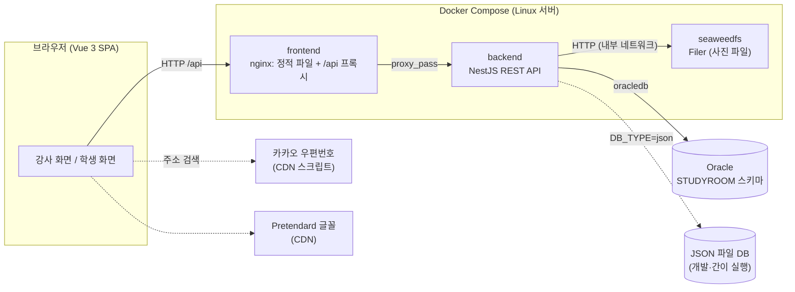
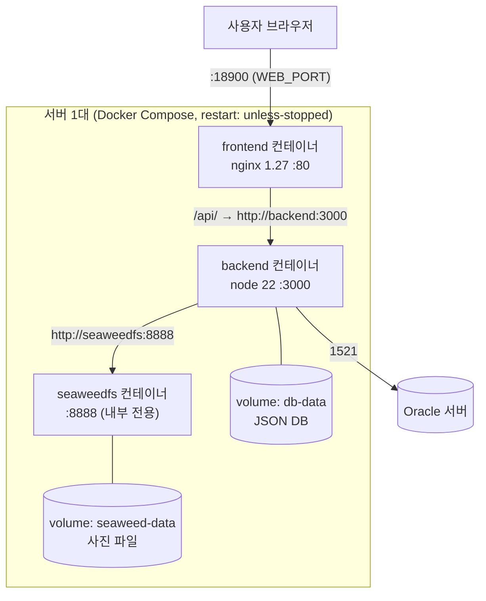
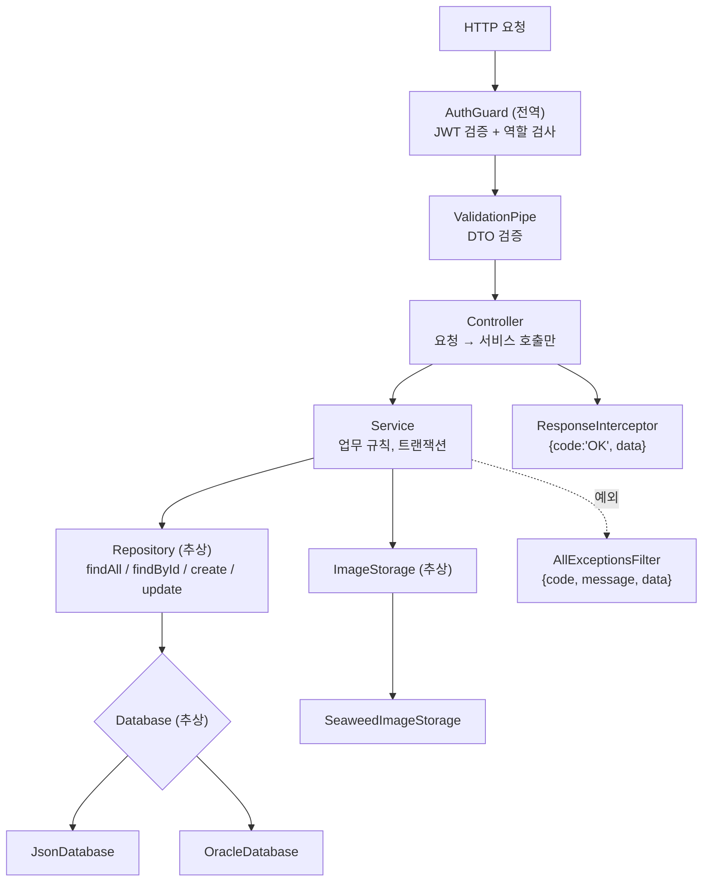
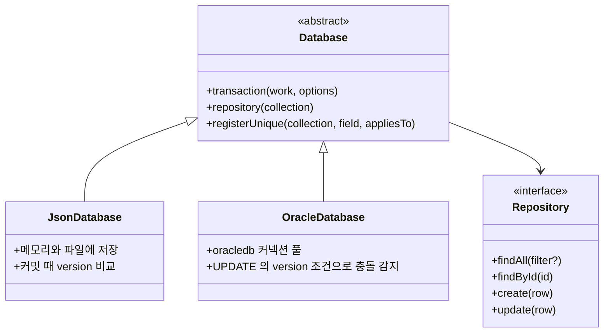
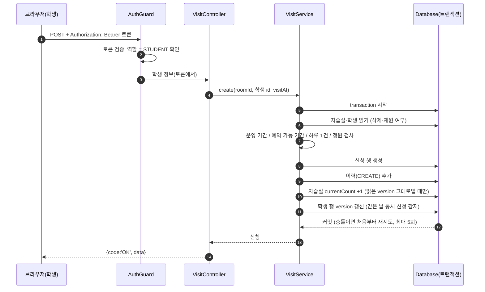
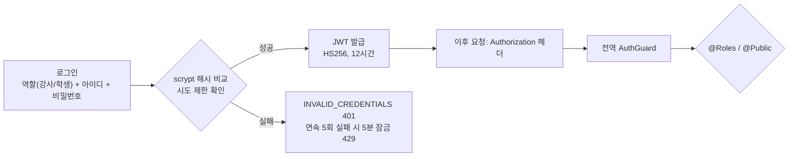
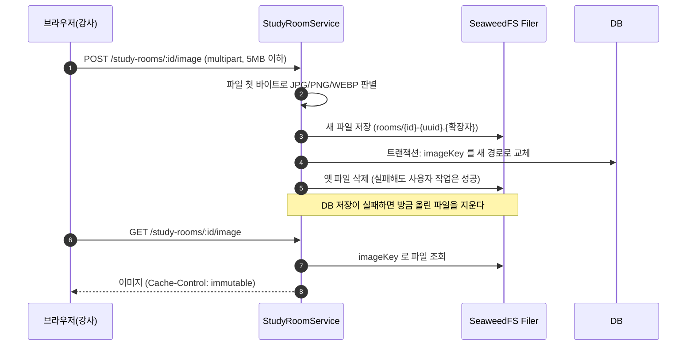
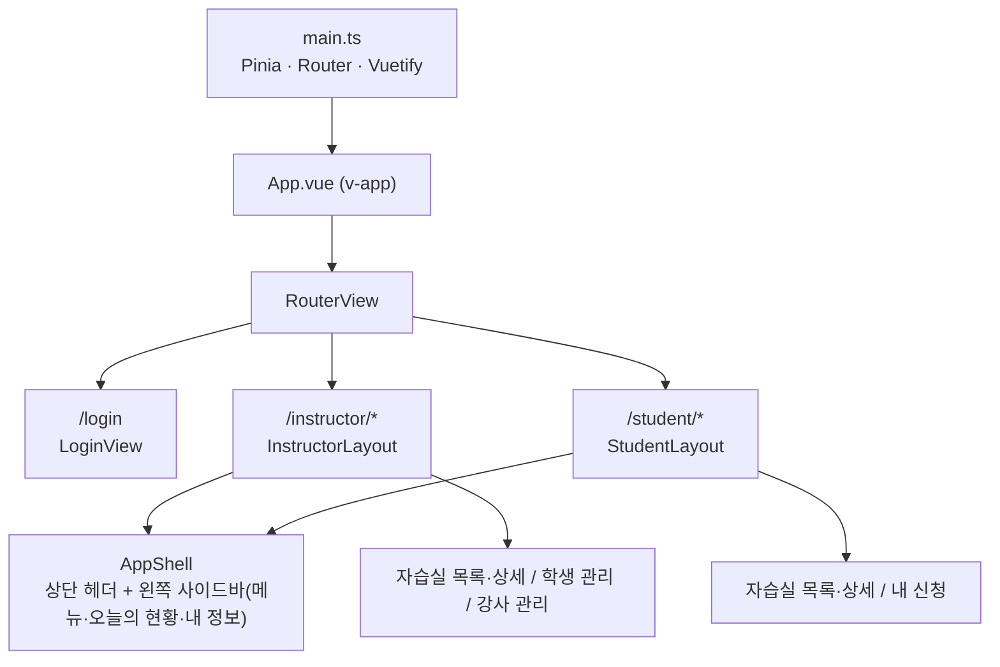

# 시스템 아키텍처

자습실 예약 시스템이 어떤 구성요소로 이루어지고, 요청이 어떻게 흐르며, 어떤 방식으로 정합성을 지키는지 정리한 문서입니다.
도표는 Mermaid로 그렸으며 GitHub에서 바로 보입니다.

## 1. 전체 구성

- 브라우저는 **같은 출처(`/api`)**로만 호출합니다. 개발 중에는 Vite 개발 서버가, 배포에서는 nginx가 `/api`를 백엔드로 전달해서 **CORS 설정이 필요 없습니다.**
- 저장소는 `DB_TYPE`으로 **Oracle**과 **JSON 파일**을 바꿀 수 있고, 서비스 코드는 어느 쪽인지 모릅니다 ([4장](#4-저장소-추상화)).
- 사진 파일은 DB가 아니라 **SeaweedFS**에 두고, DB에는 경로(`imageKey`)만 저장합니다. SeaweedFS는 외부에 포트를 열지 않고 백엔드만 접근합니다.
- 점선은 없어도 핵심 기능이 동작하는 선택 요소입니다 (JSON DB, 카카오 우편번호, 글꼴 CDN).

## 2. 배포 구성

| 컨테이너 | 이미지 | 역할 |
| --- | --- | --- |
| `frontend` | 빌드(`node:22-alpine`) → `nginx:1.27-alpine` | Vue 정적 파일 서빙, `/api` 프록시, 업로드 본문 6MB까지 허용 |
| `backend` | 빌드(`node:22-alpine`) → 실행(`node:22-alpine`, 운영 의존성만) | REST API, root가 아닌 `node` 사용자로 실행 |
| `seaweedfs` | `chrislusf/seaweedfs` | master + volume + filer 한 컨테이너 (`server -filer`) |

두 Dockerfile 모두 **빌드 단계와 실행 단계를 나눠서** 실행 이미지에 소스·개발 의존성이 들어가지 않습니다.

## 3. 백엔드 구조 (NestJS)

### 모듈

| 모듈 (`backend/src/`) | 책임 |
| --- | --- |
| `auth` | 로그인, 토큰 발급·검증, 역할 가드, 비밀번호 변경, 로그인 시도 제한 |
| `instructor` | 강사 관리(목록·등록·수정·삭제, 사번·직책·담당 과목·재직 상태 등 인사 정보, 비밀번호 재설정), 퇴직 강사 로그인 차단, 자기 삭제·퇴직 금지, 처음 실행 시 기본 계정(원장) 생성 |
| `student` | 학생 목록·등록·수정·삭제(Soft Delete), 학번 유일, 재원 상태 |
| `study-room` | 자습실 CRUD, 운영 기간·정원 규칙, 사진 등록·교체·삭제·조회 |
| `visit` | 방문 신청·시간 수정·취소, 이력 기록, 내 신청 목록, 예약 가능 기간 |
| `storage` | `Database`·`Repository` 추상화와 JSON/Oracle 구현, 낙관적 락·재시도 |
| `image` | `ImageStorage` 추상화와 SeaweedFS 구현 |
| `common` | 응답 포맷, 예외 필터, 에러 코드, `Clock`(시각 주입) |

### 설계 원칙

- **컨트롤러는 얇게, 규칙은 서비스에.** 규칙 위반은 `BusinessException('ROOM_FULL')`처럼 에러 코드로 던지고, 필터가 `{code, message, data}`로 바꿉니다. 코드와 HTTP 상태는 `common/error-code.ts` 한 곳에서 관리합니다.
- **응답은 항상 같은 모양**: 성공 `{code:'OK', message, data}`, 실패 `{code:'ROOM_FULL', ...}`. 사진 조회만 파일 자체를 내려줍니다.
- **시각은 `Clock`으로 주입**해서 테스트에서 고정할 수 있습니다 (`new Date()`를 직접 쓰지 않음).
- **쓰기는 항상 `db.transaction` 안에서.** 신청 상태·이력·현재 인원 세 가지가 한 덩어리로 반영되고, 중간에 실패하면 모두 취소됩니다.

## 4. 저장소 추상화

| 구분 | JSON 모드 (기본) | Oracle 모드 |
| --- | --- | --- |
| 설치 | 필요 없음 | Oracle + 스키마 필요 |
| 저장 | 프로세스 메모리 + 파일 전체 저장(임시 파일에 쓴 뒤 이름 변경) | 테이블 |
| 충돌 감지 | 커밋 때 staged 쓰기의 `version` 비교 | `UPDATE … WHERE id=? AND version=?` 영향 행 0 |
| 유니크 | 커밋 때 검사하는 저장소 제약 | DB 유니크 인덱스 (ORA-00001) |
| 서버 대수 | 1대 전용 | 여러 대 가능 (실제 다중 서버 검증은 하지 않음) |

저장 방식을 바꿔도 서비스·컨트롤러 코드는 그대로입니다 (`DB_TYPE` 환경 변수만 바꿈).

## 5. 요청 흐름 예시 — 방문 신청

`POST /api/study-rooms/:roomId/visits`

신청하는 학생은 **요청 본문이 아니라 토큰**에서 가져옵니다. 본문에 학생 번호를 받으면 남의 이름으로 신청할 수 있기 때문입니다.

## 6. 동시성과 정합성

여러 사람이 동시에 신청해도 정원이 넘거나 인원이 어긋나지 않도록 **낙관적 락**을 씁니다.

| 지키려는 규칙 | 문지기(충돌 감지 기준) | DB 최종 방어선 (Oracle) |
| --- | --- | --- |
| 정원 초과 금지 | **자습실 행**의 `version` | `CHECK (current_count >= 0 AND current_count <= max_personnel)` |
| 하루 1건 (같은 학생) | 같은 자습실: 자습실 행 / 다른 자습실: **학생 행**의 `version` | `uq_visit_student_day` 유니크 인덱스 (학생 + 한국 날짜) |
| 학번 중복 금지 | 커밋 때 유니크 검사 | `uq_student_no_active` (삭제되지 않은 학생끼리) |
| 같은 신청 동시 수정·취소 | 신청 행의 `version` | `UPDATE … WHERE version = ?` |

- 충돌하면 트랜잭션을 **처음부터 다시 실행**하고(최대 5회, 사이에 무작위 대기), 이번에는 바뀐 값을 보고 판단합니다. 모두 실패하면 `409 CONCURRENT_MODIFICATION`을 돌려줍니다.
- `currentCount`는 **한 곳(`VisitService.changeCount`)에서만** 바꾸고, 범위를 벗어나면 조용히 넘기지 않고 예외로 전체를 취소합니다. 테스트에서 매번 "저장된 인원 = 실제 활성 신청 수"를 검증합니다.
- 비밀번호 해시처럼 느린 계산은 **트랜잭션 밖에서** 미리 합니다 (재시도 때 다시 계산하지 않도록).

## 7. 인증과 권한

| 항목 | 내용 |
| --- | --- |
| 계정 | 강사: 로그인 아이디 / 학생: **학번** |
| 비밀번호 | scrypt + 사람마다 다른 salt로 저장 (`salt:hash`), 원문 저장 안 함 |
| 토큰 | JWT(HS256, 12시간), 서명 키는 `JWT_SECRET` |
| 권한 | 강사: 자습실·학생 관리, 이력 조회 / 학생: 방문 신청·수정·취소, 내 신청 |
| 공개 | 로그인, 자습실 사진 조회(``는 토큰을 보낼 수 없어서) |
| 로그인 제한 | 같은 계정(역할+아이디) 연속 5회 실패 시 5분 잠금 (서버 메모리에 보관) |

## 8. 자습실 사진 저장 흐름

파일 저장소와 DB는 한 트랜잭션으로 묶을 수 없어서 "새 파일 저장 → DB 교체 → 옛 파일 삭제" 순서로 하고, 사진을 바꾸면 경로(UUID)가 달라지므로 브라우저 캐시가 옛 사진을 보여주지 않습니다.

## 9. 프론트엔드 구조 (Vue 3)

| 영역 | 설명 |
| --- | --- |
| 라우팅 | `/instructor/...`, `/student/...`로 **역할별 화면 트리를 분리**하고, 라우터 가드가 로그인 여부와 역할을 확인 (서버도 역할을 다시 검사) |
| 상태 | Pinia `session` 스토어에 토큰·사용자만 보관. 서버 데이터는 각 화면이 직접 불러옴 |
| API | `api/client.ts`의 `request()` 한 곳에서 토큰 첨부, `{code,data}` 벗기기, 오류를 `ApiError`로 변환, 401이면 로그아웃 |
| 화면 | `views/`(로그인·자습실 목록/상세·학생 관리·강사 관리·내 신청), `components/`(AppShell, HeaderStatus, InfoDialog, TodayStatusPanel, RoomForm, RoomImage, AddressSearchDialog, PasswordDialog, BrandLogo), `config/academy.ts`(지점 정보) |
| 상단바 현황 | `HeaderStatus`: 지금 운영 중인 지점 수(`utils/openingHours.ts`, 한국 시간 기준), 학생은 다음 방문 일정(`/students/:id/visits`), 강사는 오늘 방문 신청 인원(`/visit-summary`). 1분마다, 그리고 신청·수정·취소가 있을 때(Pinia `status` 스토어의 신호) 다시 불러옴. 실패해도 표시만 생략 |
| 이용 안내 | `InfoDialog`: 이용 규칙(예약 가능 기간은 `/booking-policy` 값 사용)과 4개 지점의 주소·운영 시간·지도 링크(카카오맵·네이버 지도 검색) |
| 사이드바 | 넓은 화면에서는 항상 보이고 모바일에서는 햄버거로 열림. 메뉴, **오늘의 현황 패널**(자습실별 신청 인원, 30초마다 갱신), 내 정보·로그아웃 |
| 스타일 | Vuetify 테마(`plugins/vuetify.ts`) + 전역 CSS(`assets/main.css`). 시대인재 홈페이지 분위기(흰 배경, 검정 포인트, 가는 선), 모바일은 햄버거 메뉴 |
| 입력 | 화면은 형식·범위만 빠르게 안내하고, **최종 검사는 항상 서버**가 합니다 |

## 10. 외부 의존성 정리

| 의존 대상 | 쓰임 | 영향 |
| --- | --- | --- |
| Oracle | 운영 데이터 저장 | 없으면 JSON 모드로 실행 가능 |
| SeaweedFS | 자습실 사진 | 없으면 사진 기능만 막힘 (`IMAGE_STORAGE_FAILED`) |
| 카카오 우편번호 | 주소 검색 | 없으면 주소 검색만 막힘 |
| Pretendard CDN | 글꼴 | 없으면 시스템 글꼴 |

더 자세한 설계 이유와 한계는 [README의 5·6장](../README.md#5-규칙-해석-애매한-부분에-대한-결정)에 있습니다.
