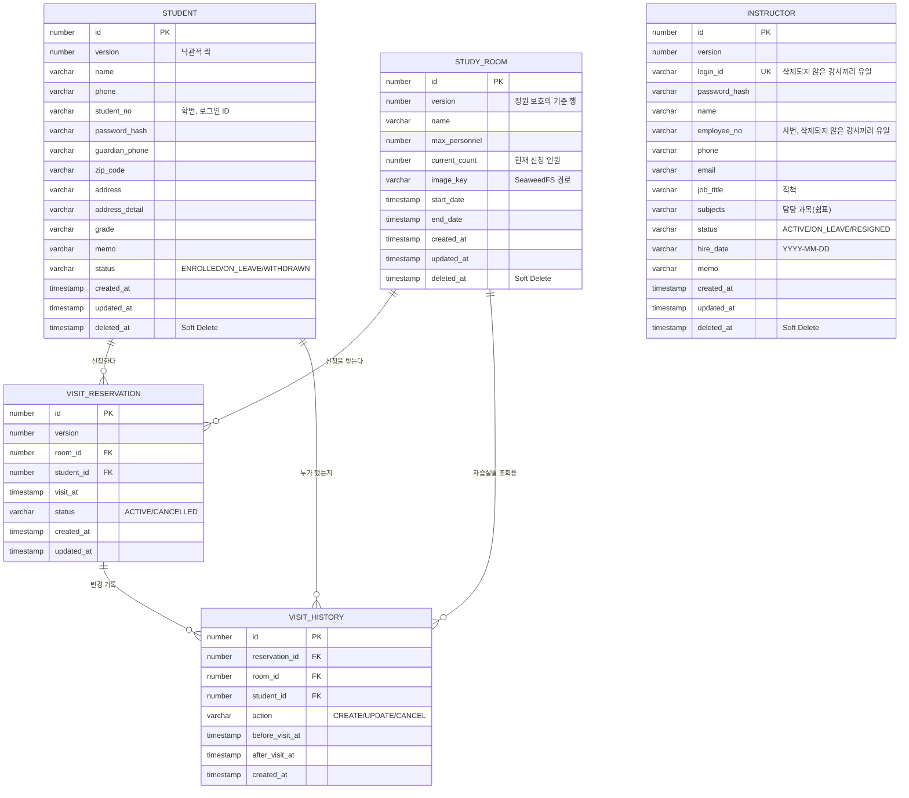

# 데이터 모델

테이블(컬렉션) 구조, 관계, 제약, 상태 값, 데이터가 바뀌는 흐름을 정리한 문서입니다.
Oracle DDL의 원본은 [`db/oracle/02_schema.sql`](../db/oracle/02_schema.sql)이고, 같은 구조를 JSON 파일 DB(`backend/data/db.json`)도 씁니다.

## 1. ER 다이어그램

- `INSTRUCTOR`는 로그인 계정이라 다른 테이블과 외래 키가 없습니다 (강사 역할이면 모든 자습실·학생을 관리할 수 있음).
- 사진 파일 자체는 테이블에 없고 `study_room.image_key`(예: `rooms/1-<UUID>.png`)가 SeaweedFS의 파일을 가리킵니다.

## 2. 공통 규칙

| 규칙 | 내용 |
| --- | --- |
| 기본 키 | `id` — Oracle은 `GENERATED ALWAYS AS IDENTITY`, JSON은 순번 부여 |
| 낙관적 락 | `version` (INSERT 때 0, 수정될 때마다 +1). 이력(`visit_history`)은 추가만 해서 version이 없음 |
| 시각 | **UTC**로 저장 (`TIMESTAMP(3)`, 기본값 `SYS_EXTRACT_UTC(SYSTIMESTAMP)`). JSON에서는 ISO 8601 문자열. 화면에서 한국 시간으로 변환 |
| 삭제 | 학생·자습실은 `deleted_at`을 채우는 **Soft Delete**. 신청·이력은 지우지 않음 |
| 이름 규칙 | Oracle `snake_case` ↔ API·JSON `camelCase` (`oracle-mappings.ts`가 변환) |
| 생성·수정 시각 | `created_at`, `updated_at` (이력은 `created_at`만) |

## 3. 테이블 상세

### 3-1. STUDENT (학생)

| 컬럼 | API 필드 | 타입 | 필수 | 설명 |
| --- | --- | --- | --- | --- |
| id | id | NUMBER | PK | |
| version | version | NUMBER(10) | ✔ | 낙관적 락 |
| name | name | VARCHAR2(30 CHAR) | ✔ | 이름 |
| phone | phone | VARCHAR2(20) | ✔ | 연락처 (형식만 검사, 중복 허용) |
| student_no | studentNo | VARCHAR2(20) | | **학번**. 삭제되지 않은 학생끼리 유일, 학생의 로그인 아이디 |
| password_hash | (응답 제외) | VARCHAR2(200) | | scrypt 해시 `salt:hash`. API 응답에 내려가지 않음 |
| guardian_phone | guardianPhone | VARCHAR2(20) | | 학부모 연락처 |
| zip_code | zipCode | VARCHAR2(5) | | 우편번호 (카카오 우편번호 검색 결과) |
| address | address | VARCHAR2(200 CHAR) | | 도로명주소 |
| address_detail | addressDetail | VARCHAR2(100 CHAR) | | 상세주소 (동·호수, 직접 입력) |
| grade | grade | VARCHAR2(10 CHAR) | | 학년 (예: 고2) |
| memo | memo | VARCHAR2(200 CHAR) | | 강사 메모 |
| status | status | VARCHAR2(10) | ✔ | 재원 상태, 기본 `ENROLLED` |
| created_at / updated_at | | TIMESTAMP(3) | ✔ | |
| deleted_at | deletedAt | TIMESTAMP(3) | | NULL = 삭제되지 않음 |

### 3-2. INSTRUCTOR (강사)

로그인 정보와, 학원에서 강사를 관리할 때 쓰는 인사·담당 정보를 함께 가집니다.

| 컬럼 | API 필드 | 타입 | 필수 | 설명 |
| --- | --- | --- | --- | --- |
| id, version | | NUMBER | ✔ | |
| login_id | loginId | VARCHAR2(50) | ✔ | 로그인 아이디, **삭제되지 않은 강사끼리 유일** (`uq_instructor_login_active`) |
| password_hash | (응답 제외) | VARCHAR2(200) | ✔ | scrypt 해시 |
| name | name | VARCHAR2(30 CHAR) | ✔ | 이름 |
| employee_no | employeeNo | VARCHAR2(20) | | **사번**, 삭제되지 않은 강사끼리 유일 (`uq_instructor_employee_active`). 처음 만든 원장 계정은 NULL |
| phone | phone | VARCHAR2(20) | | 휴대폰 번호 |
| email | email | VARCHAR2(100) | | 이메일 |
| job_title | position | VARCHAR2(20) | ✔ | **직책**, 기본 `LECTURER` |
| subjects | subjects | VARCHAR2(100) | | **담당 과목** 코드를 쉼표로 이은 문자열 (API에서는 배열) |
| status | status | VARCHAR2(10) | ✔ | **재직 상태**, 기본 `ACTIVE`. `RESIGNED`(퇴직)이면 로그인 불가 |
| hire_date | hireDate | VARCHAR2(10) | | 입사일 `YYYY-MM-DD` |
| memo | memo | VARCHAR2(200 CHAR) | | 메모 |
| created_at / updated_at | | TIMESTAMP(3) | ✔ | |
| deleted_at | deletedAt | TIMESTAMP(3) | | Soft Delete. 삭제된 강사는 로그인 불가 |

> 컬럼 이름이 `job_title`인 이유: `position`은 SQL 예약어와 비슷해서 헷갈릴 수 있어 피했습니다 (API 필드 이름은 `position`).

### 3-3. STUDY_ROOM (자습실)

| 컬럼 | API 필드 | 타입 | 필수 | 설명 |
| --- | --- | --- | --- | --- |
| id, version | | NUMBER | ✔ | **version이 정원 보호의 기준** |
| name | name | VARCHAR2(50 CHAR) | ✔ | 자습실 이름 (과제 필수 필드는 아니나 구분을 위해 추가) |
| max_personnel | maxPersonnel | NUMBER(5) | ✔ | 최대 인원 (1~500) |
| current_count | currentCount | NUMBER(5) | ✔ | 현재 신청 인원(취소 제외). **저장해 두는 값**이며 신청 때 +1, 취소 때 −1 |
| image_key | imageKey | VARCHAR2(200) | | 사진의 SeaweedFS 경로. 사진이 없으면 NULL |
| start_date / end_date | startDate / endDate | TIMESTAMP(3) | ✔ | 운영 기간 (시작 < 종료, 최대 366일) |
| created_at / updated_at | | TIMESTAMP(3) | ✔ | |
| deleted_at | deletedAt | TIMESTAMP(3) | | Soft Delete |

### 3-4. VISIT_RESERVATION (방문 신청 — 현재 상태)

신청 **한 건이 한 행**입니다. 취소해도 행은 남고(`CANCELLED`), 다시 신청하면 새 행이 생깁니다.

| 컬럼 | API 필드 | 타입 | 필수 | 설명 |
| --- | --- | --- | --- | --- |
| id, version | | NUMBER | ✔ | |
| room_id | roomId | NUMBER | ✔ | FK → STUDY_ROOM |
| student_id | studentId | NUMBER | ✔ | FK → STUDENT |
| visit_at | visitAt | TIMESTAMP(3) | ✔ | 방문 시각 (UTC) |
| status | status | VARCHAR2(10) | ✔ | `ACTIVE` 신청 중 / `CANCELLED` 취소됨 |
| created_at / updated_at | | TIMESTAMP(3) | ✔ | |

### 3-5. VISIT_HISTORY (신청·수정·취소 이력 — 추가만)

UPDATE·DELETE를 하지 않는 **감사 로그**입니다. 자습실 상세에서 바로 조회할 수 있게 `room_id`, `student_id`를 함께 저장(비정규화)합니다.

| 컬럼 | API 필드 | 타입 | 필수 | 설명 |
| --- | --- | --- | --- | --- |
| id | id | NUMBER | PK | |
| reservation_id | reservationId | NUMBER | ✔ | FK → VISIT_RESERVATION |
| room_id | roomId | NUMBER | ✔ | FK → STUDY_ROOM |
| student_id | studentId | NUMBER | ✔ | FK → STUDENT |
| action | action | VARCHAR2(10) | ✔ | `CREATE` / `UPDATE` / `CANCEL` |
| before_visit_at | beforeVisitAt | TIMESTAMP(3) | | 변경 전 방문 시각 |
| after_visit_at | afterVisitAt | TIMESTAMP(3) | | 변경 후 방문 시각 |
| created_at | createdAt | TIMESTAMP(3) | ✔ | 기록 시각 |

조회 응답에는 화면 표시를 위해 학생 이름(`studentName`, 삭제된 학생도 표시)을 덧붙입니다.

## 4. 상태 값

| 대상 | 값 | 의미 |
| --- | --- | --- |
| 학생 `status` | `ENROLLED` | 재원 — **방문 신청 가능** |
| | `ON_LEAVE` | 휴원 — 신청 불가 |
| | `WITHDRAWN` | 퇴원 — 신청 불가 |
| 강사 `status` | `ACTIVE` | 재직 |
| | `ON_LEAVE` | 휴직 — 로그인 가능 |
| | `RESIGNED` | 퇴직 — **로그인 불가** |
| 강사 직책 | `DIRECTOR` `VICE_DIRECTOR` `HOMEROOM` `LECTURER` `ASSISTANT` `STAFF` | 원장 / 부원장 / 담임강사 / 강사 / 조교 / 행정·상담 |
| 강사 담당 과목 | `KOREAN` `MATH` `ENGLISH` `SOCIAL` `SCIENCE` `KOREAN_HISTORY` | 국어 / 수학 / 영어 / 사회탐구 / 과학탐구 / 한국사 |
| 신청 `status` | `ACTIVE` | 신청 중 (정원에 포함) |
| | `CANCELLED` | 취소됨 (정원에서 빠짐) |
| 이력 `action` | `CREATE` | 신청 — 전 시각 없음, 후 시각 있음 |
| | `UPDATE` | 시간 수정 — 전·후 시각 모두 있음 |
| | `CANCEL` | 취소 — 전 시각 있음, 후 시각 없음 |

## 5. 제약과 인덱스 (Oracle)

서비스에서 검사한 규칙의 **최종 방어선**을 DB 제약으로도 둡니다. 서비스 검사가 뚫려도 DB가 막습니다.

| 이름 | 대상 | 종류 | 지키는 규칙 |
| --- | --- | --- | --- |
| `ck_student_status` | student | CHECK | 재원 상태는 3가지 값만 |
| `uq_student_no_active` | student | 함수 기반 UNIQUE 인덱스 `CASE WHEN deleted_at IS NULL THEN student_no END` | **삭제되지 않은 학생끼리 학번 유일** (삭제된 학번은 재사용 가능) |
| `uq_instructor_login_active` | instructor | 함수 기반 UNIQUE 인덱스 `CASE WHEN deleted_at IS NULL THEN login_id END` | 삭제되지 않은 강사끼리 아이디 유일 (삭제된 아이디는 재사용 가능) |
| `uq_instructor_employee_active` | instructor | 함수 기반 UNIQUE 인덱스 `CASE WHEN deleted_at IS NULL THEN employee_no END` | 삭제되지 않은 강사끼리 사번 유일 (사번이 없는 강사는 여러 명 가능) |
| `ck_instructor_title`, `ck_instructor_status` | instructor | CHECK | 직책·재직 상태는 정해진 값만 |
| `ck_room_max_positive` | study_room | CHECK | 최대 인원 ≥ 1 |
| `ck_room_count_range` | study_room | CHECK | `0 ≤ 현재 인원 ≤ 최대 인원` (정원 초과·음수 방지) |
| `ck_room_period` | study_room | CHECK | 시작 < 종료 |
| `ck_visit_status` | visit_reservation | CHECK | 신청 상태 2가지 값만 |
| `fk_visit_room`, `fk_visit_student` | visit_reservation | FOREIGN KEY | 없는 자습실·학생에 신청 금지 |
| `uq_visit_student_day` | visit_reservation | 함수 기반 UNIQUE 인덱스 (활성일 때 `student_id` + `TRUNC(visit_at + 9시간)`) | **한 학생은 한국 날짜 하루에 활성 신청 한 건** (자습실이 달라도 같음) |
| `ix_visit_room_status`, `ix_visit_student` | visit_reservation | 인덱스 | 자습실별 활성 신청 수, 학생별 신청 조회 |
| `ck_history_action` | visit_history | CHECK | 행위 3가지 값만 |
| `ck_history_shape` | visit_history | CHECK | 행위별 전·후 시각의 모양 (CREATE/UPDATE/CANCEL) |
| `fk_history_*` | visit_history | FOREIGN KEY | 신청·자습실·학생 참조 |
| `ix_history_room_created`, `ix_history_reservation` | visit_history | 인덱스 | 자습실 상세의 시간순 이력 조회 |

> `uq_visit_student_day`는 CASE로 **취소된 신청을 인덱스에서 빼서** 취소한 날에도 다시 신청할 수 있고, 한국 날짜는 UTC에 9시간을 더해 자릅니다. JSON 모드에는 DB 제약이 없어서 학번 유일은 커밋 때 검사하는 저장소 제약으로, 하루 1건은 서비스 로직과 `version`으로 보장합니다.

## 6. 데이터가 바뀌는 흐름

한 번의 쓰기 요청이 **하나의 트랜잭션**에서 여러 행을 함께 바꿉니다.

| 동작 | 신청 행 | 이력 | 자습실 | 학생 |
| --- | --- | --- | --- | --- |
| 신청 | 새 행 `ACTIVE` | `CREATE` 추가 | `current_count` +1 | version 갱신 (같은 날 동시 신청 감지) |
| 시간 수정 | `visit_at` 변경 | `UPDATE` 추가 (전·후 시각) | version 갱신 (인원은 그대로) | version 갱신 |
| 취소 | `CANCELLED` | `CANCEL` 추가 | `current_count` −1 | — |
| 학생 삭제 | — | — | — | `deleted_at` (활성 신청이 있으면 거부) |
| 자습실 삭제 | — | — | `deleted_at` (신청·이력은 그대로) | — |
| 사진 등록·교체·삭제 | — | — | `image_key` 변경 (+ SeaweedFS 파일) | — |

- 신청·수정·취소에서 **자습실 행의 version**을 올리는 이유는, 같은 자습실에 대한 요청끼리 서로 충돌을 감지하게 하려는 것입니다 (정원의 문지기).
- 서비스 규칙과 에러 코드는 [README 5장](../README.md#5-규칙-해석-애매한-부분에-대한-결정)에 있습니다.

## 7. 서비스 규칙이 만드는 데이터 제약 (요약)

| 규칙 | 값 |
| --- | --- |
| 예약 가능 기간 | 지금 ≤ 방문 시각 ≤ 지금 + 3일 (`BOOKING_MAX_DAYS_AHEAD`) |
| 하루 1건 | 한국 시간 기준, 같은 날 활성 신청은 학생당 한 건 |
| 운영 기간 | 방문 시각이 자습실의 시작~종료 안일 것, 길이 366일 이하, 종료가 이미 지난 자습실은 등록 불가 |
| 정원 | `current_count ≤ max_personnel`. 줄이려는 최대 인원이 현재 신청 수보다 작으면 거부 |
| 학생 | 재원만 신청 가능, 활성 신청이 있으면 삭제·휴원·퇴원 불가 |
| 사진 | JPG·PNG·WEBP, 5MB 이하, 파일 내용으로 형식 판별 |
| 입력 상한 | 최대 인원 500명 이하 |

## 8. 시드 데이터

처음 실행하면(데이터가 한 건도 없을 때만) 아래가 자동으로 들어갑니다. Oracle은 `db/oracle/03_seed.sql`로 같은 내용을 넣습니다.

| 대상 | 내용 |
| --- | --- |
| 강사 | 원장 계정 1개 (직책 `DIRECTOR`, 재직). 로그인 아이디와 초기 비밀번호는 환경 변수(`INSTRUCTOR_ID`·`INSTRUCTOR_PASSWORD`) 또는 코드 기본값. **처음 만들 때만** 적용 |
| 예시 강사 | 6명: 담임강사(수학) · 강사(국어·한국사) · 강사(영어) · 강사(과학·사회탐구, **휴직**) · 조교 · 행정·상담(**퇴직**). 사번 `T-001`~`T-006`, 초기 비밀번호는 사번과 같음. "사번이 있는 강사가 한 명도 없을 때" 한 번만 넣고(삭제된 강사 포함), `SEED_SAMPLE_INSTRUCTORS=false`로 끌 수 있음. 비밀번호 해시가 필요해서 Oracle에서도 SQL이 아니라 **앱이 시작할 때** 넣는다 |
| 학생 | 5명 (학번 `2026001`~`2026005`, 초기 비밀번호는 학번과 같음) |
| 자습실 | 부엉이 라이브러리 1관·2관(최대 10명), 3관(최대 5명). 운영 기간은 어제부터 30일 뒤까지, 사진 없음 |

## 9. DB 스크립트 (`db/oracle/`)

| 파일 | 용도 |
| --- | --- |
| `01_create_user.sql` | `STUDYROOM` 스키마(사용자)와 최소 권한 생성 |
| `02_schema.sql` | 테이블 5개, 제약, 인덱스 (현재 구조의 전체) |
| `03_seed.sql` | 예시 데이터 |
| `04_queries.sql` | 신청·취소·수정·삭제·로그인 등 핵심 쿼리와 낙관적 락 UPDATE 예시 |
| `05_auth_migration.sql` | 로그인 이전 스키마에 `student.password_hash`, `instructor` 추가 |
| `06_address_migration.sql` | 학생 주소 컬럼 3개 추가 |
| `07_room_image_migration.sql` | 자습실 `image_key` 컬럼 추가 |
| `08_one_visit_per_day_migration.sql` | "활성 신청 1건"을 "하루 1건"으로 변경 (제약·인덱스 교체) |
| `09_instructor_management_migration.sql` | 강사 `deleted_at` 컬럼 추가, 아이디 유일 제약을 "삭제되지 않은 강사끼리" 인덱스로 교체 |
| `10_instructor_profile_migration.sql` | 강사 등록 항목 확장: 사번·연락처·이메일·직책·담당 과목·재직 상태·입사일·메모 컬럼, 값 제약, 사번 유일 인덱스 추가, 기본 계정을 원장으로 지정 |

새로 만들 때는 01 → 02 → 03만 실행하면 되고, 05~08은 **이전 버전으로 이미 만든 DB**를 올릴 때 순서대로 필요한 것만 실행합니다.

## 10. 설계 메모

- **`current_count`를 저장하는 이유**: 신청 수를 매번 세면 계산은 어긋날 일이 없지만 동시 요청에서 정원 검사와 저장이 따로 놀 수 있습니다. 저장하되 **한 곳에서만 바꾸고, 한 트랜잭션으로 묶고, 범위를 검사하고, 테스트로 불변식을 확인**해서 어긋남을 구조로 막았습니다.
- **이력을 별도 테이블로 두는 이유**: 신청 행은 현재 상태만 갖고, 변경 내역은 이력에 쌓아 "누가 언제 무엇을 바꿨는지"를 남깁니다. 이력은 지우지 않아 삭제된 학생의 이름도 계속 보입니다.
- **`visit_history`에 `room_id`·`student_id`를 중복 저장**: 자습실 상세에서 신청 테이블과 조인하지 않고 바로 시간순 조회하려는 비정규화입니다.
- **신청 행을 되살리지 않고 새로 만드는 이유**: 같은 자습실에 날짜가 다른 신청을 여러 건 둘 수 있어야 해서, "학생당 자습실당 한 행" 제약을 두지 않았습니다 (이전에는 이 행을 되살렸으나 "하루 1건" 규칙으로 바꾸며 변경).
- **알려진 한계**: `findAll(조건)`이 Oracle에서는 테이블 전체를 읽은 뒤 코드에서 거르는 방식이라 데이터가 많아지면 `WHERE`로 내려야 합니다. 자세한 한계는 [README 6장](../README.md#6-개발하며-고민한-점--아쉬운-점)을 봅니다.
